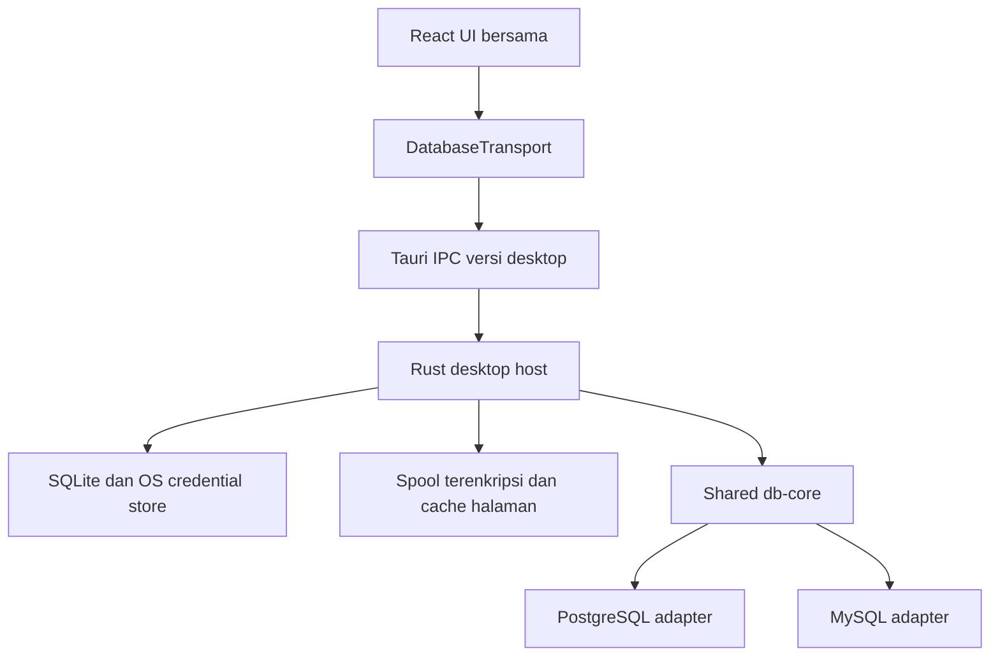

# Phase 2 — Desktop MVP Design Doc

|                       |                                                                                                           |
| --------------------- | --------------------------------------------------------------------------------------------------------- |
| **Status**            | Approved                                                                                                     |
| **Author(s)**         | Muhamad Anjar                                                                                             |
| **Reviewer(s)**       | Pengguna: konfirmasi Q1–Q18, perintah implementasi, dan persetujuan Q15                                        |
| **Tanggal Dibuat**    | 2026-10-09                                                                                                |
| **Terakhir Diupdate** | 2026-10-10                                                                                                |
| **Service Terkait**   | `apps/desktop`, `packages/`, `crates/db-types`, `crates/db-core`, `crates/db-postgres`, `crates/db-mysql` |
| **Ticket / Issue**    | N/A — implementasi lokal tanpa issue yang diketahui                                                             |

## Ringkasan (TL;DR)

Bangun Desktop MVP Tauri 2 untuk PostgreSQL/MySQL dengan UI bersama, session tetap per tab, penyimpanan lokal aman, dan hasil query besar yang memakai spool terenkripsi serta cache terbatas. Perluas Foundation untuk script, metadata lengkap, dan transaksi; status transaksi authoritative menjadi gate teknis sebelum MVP dinyatakan selesai. Keputusan Q1–Q18, implementasi, dan patch Q15 disetujui pengguna. Kode tersedia dan tervalidasi lokal Linux; status Approved dipertahankan sampai gate tiga OS, credential store, recovery, dan performa lulus.

## Latar Belakang &amp; Masalah

[Foundation](2026-10-09-foundation.md) tersedia sebagai empat crate, dengan 27 tests lulus lokal menurut [evidence Phase 1](../plans/phase-1-foundation.md). Core memiliki session tetap, satu query aktif/session, metadata terpisah, streaming terbatas, dan cancellation nyata. Saat baseline itu belum ada host Tauri atau frontend.

Pada baseline sebelum Phase 2, core memvalidasi tepat satu statement. `TransactionState` hanya `Unknown`; metadata belum mencakup seluruh object PRD atau DDL. SQLx 0.8.6 menyimpan status protocol secara internal, tetapi public transaction depth bukan bukti transaksi arbitrary SQL. Desktop memerlukan perluasan core, bukan sekadar UI di atas API yang sudah ada.

Target PRD adalah tiga OS, SQL IDE, explorer/inspector, history, dan hasil besar tanpa frontend memory tak terbatas. Tauri Channel menyediakan urutan pengiriman, tetapi API itu sendiri tidak menyediakan consumer ACK atau batas byte aplikasi; backpressure harus dirancang sepanjang alur.

## Tujuan

- Alur launch → tambah/test/connect → browse/inspect → execute/stream/cancel → transaksi → history berfungsi pada PostgreSQL/MySQL.
- Windows, macOS, dan Linux memiliki build, credential-store checks, serta native E2E sebagai gate.
- Teks/cursor/selection dan undo dipertahankan saat berpindah tab; panel dapat diubah ukurannya.
- Password tidak disimpan plaintext atau dikembalikan ke UI setelah tersimpan; SQL persisten dan spool terenkripsi.
- Benchmark target startup &lt;2 detik, idle memory &lt;200 MB, 10.000+ objects, dan 100.000+ rows; laporkan angka aktual serta kondisi pengukuran.

## Non-Tujuan (Out of Scope)

- Implementasi web/Axum/auth/tenant Phase 3; kontrak UI bersama disiapkan tanpa membuat transport web sekarang.
- SSH tunnel, code signing, auto-update, dan klaim distribusi publik siap produksi.
- Engine tambahan, advanced language engine, ER diagram, schema migration tools, AI, debugger, dan collaboration.
- Dukungan `CALL`, `COPY`, atau syntax belum terbukti melalui perubahan parser/driver diam-diam.
- Pemulihan session database, transaksi, hasil spool, atau replay SQL setelah restart.

## Proposal / Desain

### Batas komponen

| Lokasi                     | Tanggung jawab                                                                                            |
| -------------------------- | --------------------------------------------------------------------------------------------------------- |
| `apps/desktop` | Bootstrap React/Vite, command/native API Tauri, IPC dan lifecycle |
| `crates/desktop-runtime` | Sessions, SQLite/OS store, encrypted spool, script worker dan shutdown testable tanpa WebView |
| `packages/`                | UI, Monaco editor, explorer, result grid, DTO/transport bersama untuk penggunaan web berikutnya           |
| `db-types` / `db-core`     | Kontrak query/script/session/result, lifecycle, transaksi dan kebijakan resource independen dari platform |
| `db-postgres` / `db-mysql` | Protocol/status engine, eksekusi, quoting, metadata/DDL, cancellation, typed values/errors                |

Gunakan React/TypeScript, Monaco, TanStack Query untuk backend state, Zustand untuk UI state, serta virtualisasi grid. SQLite, driver, OS credential store, dan filesystem berada di Rust host. Frontend tidak mendapatkan akses shell/filesystem arbitrer. Tauri command/capability dibatasi pada fungsi aplikasi dan window/origin aplikasi.

### Connection dan session

Connection CRUD memuat nama, engine, host/port, username, database, TLS, serta timeout. TLS memverifikasi sertifikat/hostname secara default; mode lebih lemah dipilih eksplisit. Test connection tidak membuat session editor permanen. Password baru hanya dikirim melalui command khusus dan tidak muncul pada respons/list/log.

Setiap SQL tab membuka session ketika pertama diperlukan dan mempertahankan koneksi sampai close/disconnect. Kuota Foundation tetap berlaku: editor 4/profil dan 16/proses; metadata/control memiliki kuota terpisah. Reconnect membuat session baru tanpa replay. Metadata tidak melihat temporary table atau perubahan uncommitted session editor; UI menjelaskan batas ini.

Profil memiliki revisi; session menggunakan snapshot revisi saat dibuka. Perubahan target/user/credential berlaku untuk session baru. UI menampilkan revisi lama dan menawarkan reconnect. Hapus profil menyelesaikan close session dahulu sebelum menghapus secret. Close tab/aplikasi dengan query aktif atau transaksi Active/Unknown meminta keputusan pengguna; tunggu cancellation/cleanup atau disconnect eksplisit. Tidak ada otomatis Commit. Disconnect tidak menjamin SQL sebelumnya belum memiliki efek.

### Script, kontrak, dan transaksi

Current statement, selection, dan full editor dipisahkan memakai parser dialect dengan source spans yang mempertahankan teks statement; jangan split berdasarkan semicolon mentah. Validasi seluruh script sebelum eksekusi. Jalankan berurutan pada session yang sama, berhenti pada error pertama, tanpa retry atau transaksi otomatis. Cancel menghentikan statement aktif serta statement berikutnya. Catat hasil statement yang selesai sebelum kegagalan; script bukan operasi atomik.

Tambahkan identitas script/statement/result dan DTO aman untuk TypeScript, sambil mempertahankan jalur satu-statement serta regression tests Foundation. IPC memiliki versi/handshake dan menolak pasangan versi tidak kompatibel. Nilai integer besar/decimal memakai representasi lossless, bukan coercion ke JavaScript `number`; binary dan opaque memiliki encoding/tag eksplisit. Terminal tetap membedakan status, outcome, session\_valid, dan results\_complete; Cancel adalah permintaan, bukan konfirmasi rollback.

**Gate transaksi:** spike wajib membuktikan status authoritative melalui mekanisme adapter yang didukung. PostgreSQL membedakan Idle/Active/Failed; MySQL tidak dipaksa mengikuti failed-block PostgreSQL. Unknown tetap dipakai ketika tidak dapat dipastikan. Public SQLx transaction depth dan parsing teks SQL tidak digunakan sebagai database truth. Patch/pergantian driver memerlukan review desain tersendiri sebelum diterapkan.

Auto Commit OFF membuka transaksi secara eksplisit sebelum statement biasa ketika session terkonfirmasi Idle. Tindakan ini adalah kontrol transaksi pilihan pengguna, bukan rewrite SQL. Commit/Rollback berjalan pada session tab; explicit transaction SQL dihormati tanpa nesting otomatis. Perubahan mode ke ON saat aktif meminta Commit/Rollback. Unknown menghalangi perubahan mode sampai dipulihkan. Implicit commit MySQL/DDL ditampilkan berdasarkan status engine. Gate mencakup raw BEGIN/COMMIT/ROLLBACK, failed transaction, cancel, disconnect, dan implicit commit.

Basic EXPLAIN merupakan tindakan eksplisit, tampil table/text, tanpa ANALYZE otomatis. Syntax yang belum terbukti, termasuk batas Foundation seperti CALL/COPY/PREPARE/EXECUTE, tidak dibuka hanya karena editor tersedia.

### Hasil, spool, dan IPC

Host mengonsumsi stream core bertahap dan menulis spool terenkripsi beserta indeks halaman. UI menerima notifikasi berurutan melalui Channel dengan ACK/antrean terbatas dan meminta halaman rows yang diperlukan. Shared transport mempertahankan lifecycle streaming, tetapi row delivery mengikuti demand, tidak mengumpulkan semua rows di frontend. Status terminal dapat diambil melalui command terpisah ketika UI terlambat merespons.

| Resource    | Batas awal disepakati                                                 |
| ----------- | --------------------------------------------------------------------- |
| Cache hasil | 32 MiB/tab, 128 MiB/aplikasi                                          |
| Spool       | 1 GiB/hasil, 4 GiB/aplikasi                                           |
| Core        | Batch/queue, kuota, backpressure dan cleanup Foundation tetap berlaku |

Batas cache mengukur retained application data, bukan hard RSS; alokasi driver, serialisasi, Monaco, dan WebView harus dibenchmark. Jika disk penuh/quota tercapai, minta cancellation, hentikan kelanjutan script, pertahankan hasil parsial, dan tampilkan alasan; completion yang menang race tetap dihormati. Hasil yang tersedia tidak boleh ditampilkan sebagai lengkap tanpa indikator.

Kunci spool hanya dalam memori, tidak dipersistenkan; hasil tidak dapat dipulihkan setelah restart. Hapus spool saat hasil ditutup dan bersihkan orphan saat startup setelah crash. File berada di directory aplikasi dengan permission terbatas. Enkripsi harus authenticated dan indeks/data sensitif dilindungi; library/format dan parameter page/ACK harus direview sebelum implementasi terkait.

Grid virtualized mendukung NULL, cell/row selection, copy cell/rows/CSV. Sorting/filtering hasil SQL berlaku pada rows yang sudah diterima, dengan label parsial; tidak mengubah SQL pengguna. Operasi terhadap seluruh hasil berjalan pada host/spool dengan resource terbatas, bukan memuat semua rows ke browser.

### Explorer dan table viewer

Lazy loading dan capabilities menentukan object yang tersedia. Lengkapi PostgreSQL materialized views, functions/procedures, triggers, enum/custom types; MySQL functions/procedures/triggers; metadata keys/indexes/constraints dan DDL harus diverifikasi. Membaca definisi routine tidak berarti CALL dapat dieksekusi.

Inspector menyediakan Data, Columns, Indexes, Constraints, Foreign Keys, DDL. Table viewer default 100 rows; pagination/sorting/filtering dilakukan di database dengan identifier yang di-quote adapter dan nilai parameterized. Tanpa key unik, tampilkan bahwa halaman dapat berubah; jangan menjanjikan snapshot konsisten. Autocomplete memakai metadata yang sudah dimuat atau diminta secara terarah, bukan seluruh katalog saat connect.

### SQLite, secrets, dan privacy

SQLite menyimpan connection metadata/revisi/secret reference, settings, workspace layout, recent files, saved queries, dan history. Model final/constraints dituangkan dalam migrasi bernomor sebelum implementasi persistence, bukan dianggap schema sudah tersedia.

Password dan kunci enkripsi SQL berada di store platform yang dipilih eksplisit: Windows/macOS native store dan Linux persistent Secret Service. Jangan memilih backend otomatis yang dapat menjadi sample/nonpersistent store. Store terkunci/tidak tersedia dibedakan dari credential tidak ditemukan. Pengguna dapat memasukkan password untuk session memory-only; tidak ada fallback plaintext.

Perubahan credential membuat reference baru → update SQLite secara atomik → hapus secret lama. Tidak ada transaksi atomik lintas store; gunakan operasi idempotent dan recovery/pembersihan secret yatim. Penghapusan gagal dicatat sebagai cleanup tertunda, tidak membuat secret kembali masuk UI/log.

History dan restore teks editor default OFF, opt-in per connection. Teks history/editor/saved query dienkripsi; kunci berada di OS store. Store tidak tersedia menghalangi penyimpanan/pembacaan teks terenkripsi, tetapi editor memory-only tetap berjalan. Saved query disimpan lewat tindakan eksplisit. History dibatasi 30 hari atau 1.000 eksekusi/koneksi; mematikan history menawarkan hapus data lama. Saved query tidak dihapus otomatis. Layout dapat dipulihkan tanpa auto-connect/replay; undo dipertahankan antartab, tidak dijanjikan setelah restart.

Migrasi SQLite bernomor membuat backup sebelum perubahan schema; kegagalan menghentikan persistence tanpa menghapus data. Aplikasi lama menolak schema yang lebih baru. Rollback memulihkan backup dengan aplikasi yang sesuai; tidak ada automatic downgrade. Backup tetap sensitif dan tidak mengandung plaintext SQL/password. Restore SQLite tidak memulihkan OS secrets yang sudah dihapus; recovery harus meminta credential jika reference hilang.

### Parameter implementasi yang ditetapkan

`crates/desktop-runtime` memiliki persistence, spool, dan registry; host Tauri hanya wiring command/native lifecycle. Dependency dikunci pada Cargo/pnpm lock: Tauri 2, React 19, Monaco 0.57, keyring 3.6.3, rusqlite 0.32.1, dan chacha20poly1305 0.10.1. OS backend dipilih eksplisit: native Windows/macOS, persistent Secret Service Linux.

Ciphertext SQL/spool memakai XChaCha20-Poly1305 dengan nonce acak 24 bytes dan key 32 bytes. Key SQL berada di OS store; key spool ephemeral. SQLite schema 1 memakai migrasi transaction, backup, schema-version guard, dan pending cleanup references. Layout hanya menyimpan field yang diizinkan. Recent files diakses melalui native picker/reference, bukan arbitrary path dari UI.

Script 1 MiB/1.000 statements; batch/page 256 rows dan 2 MiB; metadata response maksimal 8 MiB. Channel memakai satu credit dengan ACK sequence sekali pakai dan timeout 30 detik; terminal dapat dipull terpisah. Saved-query headers dipaginasi 100 tanpa SQL; teks dibaca per dokumen, restore maksimal 16 editor/profil dan 64 aplikasi. PostgreSQL table DDL direkonstruksi untuk inspeksi, bukan backup/migration script.

[Review patch driver](phase-2-driver-status-review.md) dan [laporan validasi](../plans/phase-2-desktop-mvp-validation.md) mencatat bukti dan keterbatasan parameter ini.

### Log keputusan

1. Q1: Desktop MVP lengkap termasuk perluasan core; SSH/signing/update ditunda.
2. Q2: UI dan transport bersama sejak desktop; web implementation pada Phase 3.
3. Q3: Session tetap per tab, lazy open, reconnect tanpa replay.
4. Q4: Hasil besar memakai spool sementara terlindungi dan cache terbatas.
5. Q5: History/restore SQL opt-in per koneksi; layout restore tanpa auto-connect.
6. Q6: Script dialect-aware berurutan, preflight, stop-first-error/cancel, tanpa auto-transaction/retry.
7. Q7: Cache 32/128 MiB; spool terenkripsi 1/4 GiB; hasil parsial saat batas tercapai.
8. Q8: OS store gagal menawarkan memory-only; secret reference baru saat perubahan.
9. Q9: Close query/transaksi aktif atau Unknown meminta keputusan; tidak auto-Commit.
10. Q10: Tiga OS menjadi gate; Vitest/RTL dan native WebdriverIO Tauri; paket lokal unsigned.
11. Q11: Rust owns spool; IPC notifications dengan ACK dan page pull terbatas.
12. Q12: Migrasi/backup/schema guard; koordinasi secrets idempotent dan orphan cleanup.
13. Q13: Sorting/filtering result hanya rows diterima; table viewer memakai database.
14. Q14: SQL persisten terenkripsi; history 30 hari/1.000 eksekusi per koneksi.
15. Q15: Status transaksi authoritative wajib spike; driver change memerlukan review.
16. Q16: Auto Commit OFF membuka transaksi ketika Idle; mode switch dikonfirmasi.
17. Q17: IPC versioned/lossless DTO; jalur dan regression tests Foundation dipertahankan.
18. Q18: Profil direvisi untuk session baru; hapus setelah cleanup; TLS verification default.

## Alternatif yang Dipertimbangkan

| Alternatif                              | Kelebihan                                                  | Kekurangan                               | Kenapa tidak dipilih                                   |
| --------------------------------------- | ---------------------------------------------------------- | ---------------------------------------- | ------------------------------------------------------ |
| UI bersama + host tipis — dipilih       | Reuse web dan batas ownership jelas                        | Butuh kontrak transport sejak desktop    | Dipilih untuk arsitektur PRD                           |
| UI desktop khusus lalu dipisah          | Setup awal lebih kecil                                     | Refactor/duplikasi Phase 3               | Menunda batas yang sudah dibutuhkan                    |
| Spool terenkripsi + page pull — dipilih | Semua hasil dalam quota dapat ditelusuri; frontend bounded | Disk, enkripsi, indeks dan cleanup       | Dipilih; benchmark wajib                               |
| Cache sejumlah rows saja                | Tidak memerlukan spool                                     | Hasil besar harus dibatasi/dibuang       | Tidak memenuhi pilihan pengguna atas penelusuran hasil |
| Stream seluruh rows ke Channel          | Implementasi awal sederhana                                | Core bounded tidak menjamin IPC bounded  | Tidak memenuhi resource policy                         |
| Session per tab — dipilih               | Transaksi/temp/settings terisolasi per editor              | Lebih banyak koneksi                     | Dipilih dengan kuota Foundation                        |
| Session per profil                      | Koneksi lebih sedikit                                      | Tab saling memengaruhi dan berebut query | Tidak sesuai semantics tab yang dipilih                |
| OS store + SQL terenkripsi — dipilih    | Data lokal lebih terlindungi                               | Store gagal membatasi persistence        | Dipilih dengan memory-only fallback                    |
| History plaintext default aktif         | Praktis dan sederhana                                      | SQL sensitif persisten tanpa consent     | Tidak memenuhi privacy yang disepakati                 |
| Status protocol terbukti — dipilih      | UI transaksi mencerminkan database                         | Bisa memerlukan perubahan driver         | Terbukti pada integrasi kedua engine; lihat laporan validasi                            |
| Infer transaksi dari SQL/counter        | Mudah diimplementasikan                                    | Salah pada arbitrary SQL/implicit commit | Bukan authoritative                                    |

## Dampak &amp; Risiko

- **Backward compatibility:** tambahkan kontrak script/metadata/status dan IPC versioned tanpa menghapus jalur Foundation. DTO lossless mencegah perubahan nilai saat masuk JS. Jalankan regression tests kedua engine; perubahan driver/API harus direview sebelum consumer mengikuti.
- **Migrasi data:** persistence baru, tanpa migrasi customer database. SQLite memakai backup/migrasi bernomor dan schema-version guard. OS store tidak atomic dengan SQLite; failure/recovery tests wajib. Rollback backup mungkin memerlukan input ulang credential yang sudah dihapus. Backup/ciphertext harus dilindungi; jangan menghapus data pengguna demi pemulihan.
- **Performa:** spool menambah disk I/O/enkripsi; virtualisasi tidak otomatis membatasi retained rows atau IPC. Ukur RSS total, startup, idle, katalog, hasil besar, disk penuh, slow consumer, dan concurrent tabs. Batas awal bukan hasil benchmark.
- **Keamanan:** secrets dan teks SQL persisten terenkripsi, permission Tauri minimal, tidak ada shell/filesystem arbitrer. Debug/log/error tetap sanitized. TLS default verified; encrypted spool tidak melindungi data ketika proses pengguna sudah dikompromikan. Pilihan library/encryption/backend harus direview dan diuji di tiga OS.
- **Operasional:** build/E2E native tiap OS, dependency lock, test automation plugin hanya pada build pengujian. Production bundle tidak memuat izin automation. Paket unsigned hanya untuk validasi lokal; signing/update ditunda. Shutdown menunggu core cleanup; crash membersihkan spool, bukan replay. Rollback release menghormati schema version dan backup.

## Rencana Implementasi (opsional)

Ikuti [plan Phase 2](../plans/phase-2-desktop-mvp.md): review/gate → spike core/IPC/persistence → host dan UI bersama → connection/session → explorer/inspector → editor/transaksi → spool/grid → privacy/history/workspace → native E2E/benchmark/packages.

Vitest + React Testing Library memeriksa state/forms/editor/tree/grid; WebdriverIO dengan layanan Tauri memeriksa alur Rust/database nyata. Browser dengan mock IPC bukan bukti native. Uji credential store tersedia/locked/missing, secret update failure, migration failure/restart, crash cleanup, byte quotas, slow consumers, precision, cancellation race, dan transaksi kedua engine. Tiga OS perlu evidence tersendiri; CI yang belum tersedia tetap gate kosong.

## Pertanyaan Terbuka

- Runner Windows/macOS interaktif, fixture, dan credential store unlocked belum divalidasi; workflow tersedia tetapi belum dijalankan.
- Probe Secret Service Linux pada mesin ini tidak tersedia. Dibutuhkan bukti OS-store tersedia/locked/missing dan history/restore native, tanpa fallback plaintext.
- Recovery lintas SQLite/OS secrets dan close/crash/migration-failure perlu uji platform nyata; unit controlled-store belum membuktikan semua recovery operasional.
- Stress slow ACK/consumer close/disk-full native serta cold startup, idle RSS, dan katalog UI besar masih gate. Angka core/native debug tersedia dalam laporan, bukan pengganti seluruh benchmark.
- Signing, update, dan public release tetap di luar scope; paket lokal tidak menutup gate distribusi.

## Referensi

- [PRD](../../PRD.md), [Foundation](2026-10-09-foundation.md), [plan Phase 2](../plans/phase-2-desktop-mvp.md).
- [Desktop workspace](../features/desktop-workspace.md), [editor/grid](../features/sql-editor-result-grid.md), [query/session](../features/query-sessions-streaming.md), [security](../features/connection-security.md), [explorer](../features/database-explorer-inspector.md).
- [Tauri frontend communication](https://v2.tauri.app/develop/calling-frontend/), [Channel API](https://docs.rs/tauri/latest/tauri/ipc/struct.Channel.html), [Channel source](https://docs.rs/tauri/latest/src/tauri/ipc/channel.rs.html): ACK/byte limits adalah kebutuhan aplikasi, bukan jaminan Channel.
- [Tauri WebDriver](https://v2.tauri.app/develop/tests/webdriver/), [WebdriverIO platform support](https://webdriver.io/docs/desktop-testing/tauri/platform-support), [test-only plugin setup](https://webdriver.io/docs/desktop-testing/tauri/plugin-setup).
- [SQLx 0.8.6 Connection source](https://github.com/launchbadge/sqlx/blob/v0.8.6/sqlx-core/src/connection.rs), [PostgreSQL internal status](https://github.com/launchbadge/sqlx/blob/v0.8.6/sqlx-postgres/src/connection/mod.rs), [MySQL internal status](https://github.com/launchbadge/sqlx/blob/v0.8.6/sqlx-mysql/src/connection/mod.rs), [PostgreSQL 16 ReadyForQuery](https://www.postgresql.org/docs/16/protocol-message-formats.html).
- [Keyring backend selection](https://docs.rs/keyring/latest/keyring/), [store errors](https://docs.rs/keyring-core/latest/keyring_core/error/enum.Error.html), [Linux Secret Service store](https://docs.rs/zbus-secret-service-keyring-store/latest/zbus_secret_service_keyring_store/).

