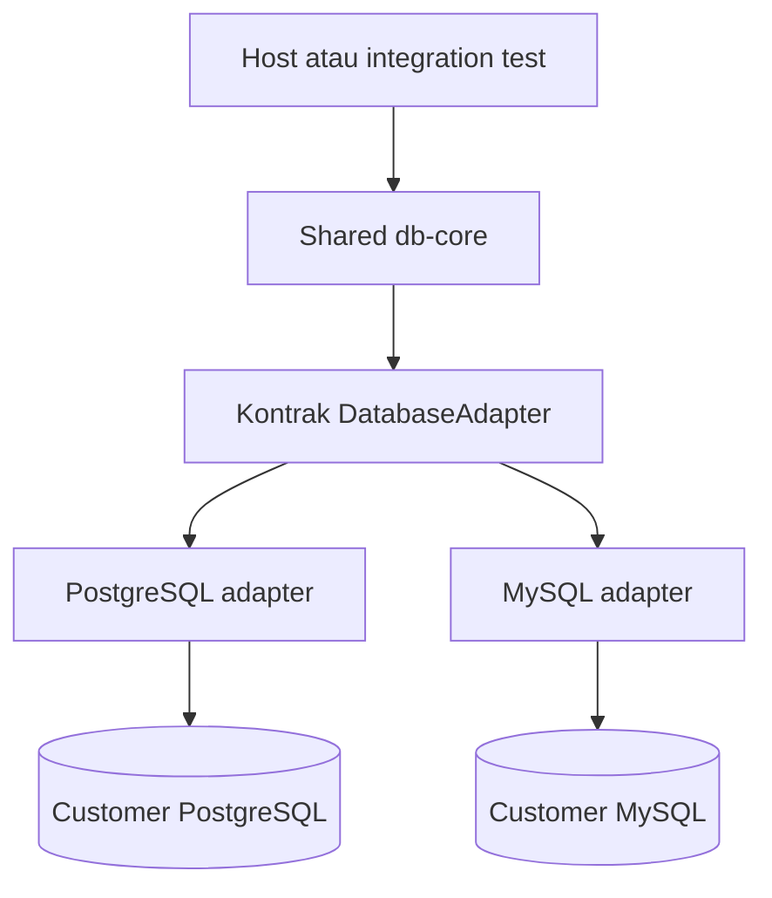

# Foundation Database Studio Design Doc

| | |
|---|---|
| **Status** | Implemented |
| **Author(s)** | [perlu konfirmasi: nama penulis dari pengguna] |
| **Reviewer(s)** | [perlu konfirmasi: reviewer Rust/database] |
| **Tanggal Dibuat** | 2026-10-09 |
| **Terakhir Diupdate** | 2026-10-09 |
| **Service Terkait** | Rencana: `crates/db-types`, `crates/db-core`, `crates/db-postgres`, `crates/db-mysql`; host Tauri/Axum pada fase berikutnya |
| **Ticket / Issue** | N/A: tidak ada ticket/issue yang diberikan |

## Ringkasan (TL;DR)

Bangun Foundation Database Studio sebagai shared Rust core dengan empat crate awal untuk tipe, koordinasi core, serta adapter PostgreSQL/MySQL. Session memegang koneksi tetap dengan satu query aktif, hasil di-stream melalui buffer terbatas, dan cancellation menghentikan query di database. Phase 1 telah diimplementasikan dan diuji lokal; kontrak serta batas resource tersedia dalam types/core, dengan keterbatasan RSS, dialect, dan platform lanjutan dicatat eksplisit.

## Latar Belakang & Masalah

Saat desain awal ditulis repository hanya berisi PRD dan panduan contributor. Kini shared Rust Foundation serta build/test setup tersedia; UI desktop/web belum diimplementasikan. PRD membutuhkan satu core yang dipakai desktop dan web, tetapi contoh interface belum menetapkan seluruh kontrak runtime. Pool acak per statement merusak transaksi, temporary table, dan session settings; mengumpulkan seluruh rows meningkatkan memory dan menunda hasil pertama.

Pengguna menyetujui dokumentasi lima fase dengan Phase 1 paling rinci, pemisahan feature/plan/design doc, empat crate Foundation, koneksi tetap per session, satu query aktif per session, dan penundaan detail kontrak/resource ke checklist keputusan sebelum implementasi. Pengguna mereview desain melalui sesi grilling dan mengotorisasi implementasi Phase 1 setelah Q1–Q20 disepakati. Persetujuan mencakup arah desain; pengujian spike tetap wajib sebelum melengkapi core.

## Tujuan

- Shared core independen dari React, Tauri, Axum, HTTP, dan WebSocket.
- PostgreSQL/MySQL dapat connect, inspect metadata, execute, stream, cancel, dan disconnect sesuai PRD §56.
- Perilaku session persisten dan fitur engine-specific dipertahankan melalui capabilities.
- Buffer/session dibatasi oleh kebijakan eksplisit yang diselesaikan sebelum implementasi terkait.
- Unit dan integration tests kedua engine membuktikan acceptance criteria sebelum Phase 2.

## Non-Tujuan (Out of Scope)

- UI desktop/web, public HTTP/IPC API, autentikasi, schema aplikasi, deployment produksi.
- Crate tambahan seperti `db-query`, `db-metadata`, `db-security`, `sql-language`, atau `workspace-core` sebelum kebutuhan pemisahan jelas.
- Query worker terpisah, engine tambahan, advanced schema tools, AI, enterprise SSO, atau fitur Phase 4–5.

## Proposal / Desain

### Batas komponen

| Komponen | Tanggung jawab awal |
|---|---|
| `db-types` | Config, capabilities, identifiers, object metadata, query request/result/event, typed errors |
| `db-core` | Kontrak adapter, connection/session coordination, lifecycle/query coordination, aturan resource dan cleanup |
| `db-postgres` | SQLx/driver PostgreSQL, introspection, type/error mapping, streaming, cancellation engine-specific |
| `db-mysql` | SQLx/driver MySQL, introspection, type/error mapping, streaming, cancellation engine-specific |

Metadata dan query lifecycle menjadi modul dalam crate tersebut. Concrete adapters memenuhi kontrak core; core tidak bergantung pada adapter konkret. Host atau integration test menghubungkan implementasi adapter. Detail pemisahan types/trait ditetapkan saat kontrak Rust difinalisasi; tabel ini membatasi tanggung jawab, bukan signature yang sudah diimplementasikan.

Alur runtime rencana:

Diagram menunjukkan alur pemanggilan, bukan dependency core terhadap concrete adapters. UI dan transport ditambahkan setelah core usable. Schema aplikasi/migrasi dan public transport API: N/A pada Phase 1; dirancang pada fase platform terkait.

### Session & connection

Setiap session mempertahankan satu koneksi database yang sama. Maksimal satu query aktif pada session; query paralel memakai session berbeda. Ini mempertahankan BEGIN/COMMIT/ROLLBACK, temporary tables, dan session settings. Pemakaian pool tidak boleh mengubah koneksi milik session di antara statement.

Session sibuk ditolak dengan `SESSION_BUSY`. Default editor: 4 session/profil dan 16/proses. Metadata dan kontrol cancellation mempunyai kuota terpisah, masing-masing 1/profil dan 4/proses. Kuota mencakup koneksi yang sedang dibuka; kapasitas penuh ditolak tanpa eviction. Tidak ada idle eviction otomatis. Connect timeout 10 detik; query timeout opsional. Reconnect membuat session baru tanpa replay SQL. Close/disconnect dan shutdown host melepas resource; koneksi terputus menginvalidasi session. Metadata tidak memakai session editor dan tidak melihat uncommitted changes atau temporary table editor. Identifier object terstruktur: engine, database, schema opsional, nama, dan jenis; quoting milik adapter.

### Query lifecycle & streaming

Gunakan lifecycle PRD: Created, Running, Streaming, Completed, Failed, Cancelled. Success/failure/cancellation bersifat terminal sesuai kontrak pada types/core. Events minimum mengikuti PRD §20: start, columns, rows, completed, failed, cancelled. Schema event Foundation berada di `db-types`; ID query/session/connection dan started_at_ms muncul pada setiap event. Summary membedakan rows_returned, affected_rows, dan results_complete; completion setelah interruption tidak menyembunyikan hasil parsial. Transport desktop/web perlu menilai versi/kompatibilitas kontrak ini.

Kirim rows per batch sebelum seluruh hasil terkumpul. Gunakan buffer terbatas dan kebijakan producer/consumer eksplisit. Batch maksimal 256 rows atau 1 MiB; antrean data maksimal 4 MiB/query. Byte accounting mengukur payload nilai dan metadata batch, bukan total RSS. Buffer penuh memberi backpressure; terhalang selama 30 detik memicu cancellation. Consumer drop memicu cancellation. Satu row > batas batch ditolak dengan `RESULT_ROW_TOO_LARGE` tanpa pemotongan. Batas aplikasi tidak membatasi alokasi message/row SQLx; RSS/large-row tests tetap diperlukan. Nilai wajib: NULL, boolean, signed/unsigned integer, float, exact decimal, text, binary, date/time/timestamp, JSON. Tipe lainnya memakai opaque engine type/format/payload hanya jika lossless; jika tidak, `UNSUPPORTED_DATA_TYPE`. Query/session/connection IDs stabil sepanjang lifecycle; hanya satu event terminal. SQL pengguna tidak dimodifikasi otomatis.

### Cancellation & error

Cancellation menginstruksikan driver/engine menghentikan query; status UI saja tidak cukup. Error dikembalikan sebagai typed error dengan kategori dan database code yang aman. Cancellation memakai koneksi kontrol dengan kredensial profil yang sama, tanpa requirement superuser. `cancel()` mengajukan permintaan; event terminal mengonfirmasi hasil. Completion yang menang race tetap Completed; cancellation database yang terkonfirmasi menjadi Cancelled. Repeated cancel tidak mengubah terminal. Deadline cancel/cleanup 5 detik; ketidakpastian menjadi `QUERY_OUTCOME_UNKNOWN` dan session invalid. Session hanya reusable setelah respons selesai dan protocol synchronized; tidak ada otomatis ROLLBACK. Status transaksi Unknown sampai driver dapat mengonfirmasi; wrapper transaction depth SQLx tidak authoritative untuk arbitrary SQL. Failed/Cancelled bukan jaminan rollback efek data. SQL/error/secret tidak dicatat mentah dalam logs. Perbedaan mekanisme PostgreSQL/MySQL tetap di adapter.

### Environment & validasi

Compose development menyediakan database customer PostgreSQL/MySQL dan application PostgreSQL terpisah. Foundation tidak membuat schema aplikasi. Integration tests memakai fixture disposable dengan nama object unik; core tidak memakai application pool. Host mendaftarkan ProtectedTarget untuk endpoint control plane; guard endpoint bukan pengganti tenant authorization/DNS policy. Rust 1.99.0, SQLx 0.8.6, sqlparser 0.63.0, PostgreSQL 16.13, MySQL 8.4.8 dipakai pada validasi; versions/lockfile/image digests dikunci.

Unit tests memeriksa capabilities, metadata, lifecycle, dan typed errors. Integration tests memeriksa workflow §56, session persistence, buffering/streaming, cancellation nyata, serta cleanup. Performa diukur setelah implementasi; benchmark UI/desktop target PRD berlangsung pada fase terkait.

### Kontrak SQL & spike

Foundation memvalidasi tepat satu statement memakai parser dialect, menolak CALL sebelum eksekusi, dan mengirim teks SQL asli tanpa rewrite. Syntax yang tidak dapat dipastikan parser menjadi UNSUPPORTED_STATEMENT. Implementasi juga menolak PREPARE/EXECUTE (bypass CALL), COPY (protocol khusus), serta MySQL executable comments (kode yang dipandang parser sebagai whitespace). DO PostgreSQL belum didukung parser. SQL tidak di-rewrite untuk mengatasi batas ini. Script/multiple results dibahas sebelum full editor Phase 2.

Spike SQLx/parser dijalankan lebih dahulu dan lulus: persistensi session, validasi SQL/semicolon bodies, cancellation sebelum row pertama/during streaming/blocked lock, protocol recovery, privileges, consumer drop, cleanup timeout, dan large rows. Toolchain, dependencies, dan image digests dikunci; hasil menentukan kelayakan driver. Tidak ada retry SQL otomatis.

### Log keputusan yang disepakati

1. Roadmap lima fase; Phase 1 paling rinci dan kini terimplementasi, Phase 2–5 tetap rencana.
2. Gunakan `docs/features/`, `docs/plans/`, `docs/design-docs/` dengan indeks dan tautan silang.
3. Empat crate Foundation; metadata/query lifecycle sebagai modul terlebih dahulu.
4. Satu koneksi tetap dan maksimal satu query aktif per session; paralelisme memakai session berbeda.
5. Bounded streaming dan cancellation nyata wajib.
6. Q1–Q20 pada sesi grilling menetapkan busy rejection, metadata isolation, lossless values, resource/time limits, SQL subset, dan cancellation/recovery contract di atas. Pengguna mengotorisasi kode Phase 1 beserta pembaruan dokumentasi; desain fase berikutnya tetap terpisah.

## Alternatif yang Dipertimbangkan

| Alternatif | Kelebihan | Kekurangan | Kenapa tidak dipilih |
|---|---|---|---|
| Empat crate dengan modul metadata/query — dipilih | Batas core/engine jelas, setup awal kecil | Modul dapat perlu dipisah ketika tumbuh | Dipilih untuk Foundation; pemisahan berikutnya perlu alasan teknis |
| Seluruh crate target PRD sejak awal | Batas package lengkap dari awal | Pembagian tanggung jawab dan dependency belum terbukti | Menambah struktur sebelum kebutuhan jelas |
| Koneksi tetap per session — dipilih | Menjaga transaction/temp table/settings | Memakai resource per session; perlu limit/cleanup | Dipilih untuk memenuhi semantics PRD §17 |
| Pool checkout per statement | Mudah untuk query stateless | Merusak session persistence | Tidak memenuhi kebutuhan transaksi/session |
| Desain arah sekarang, detail kontrak sebelum milestone — dipilih | Roadmap tersedia tanpa signature/resource tebakan | Implementasi menunggu keputusan penghambat | Dipilih pengguna; seluruh penghambat dicatat eksplisit |
| Seluruh kontrak final sebelum dokumentasi awal | Lebih banyak detail tersedia di awal | Membutuhkan sesi desain lebih panjang dan bukti driver | Tidak dipilih untuk pekerjaan dokumentasi awal |

## Dampak & Risiko

- **Backward compatibility:** Foundation menambahkan kontrak Rust baru, tanpa mengubah HTTP/IPC API yang sudah berjalan. Consumer repository saat ini adalah example dan tests. Perubahan types/events setelah integrasi platform harus dinilai kompatibilitasnya.
- **Migrasi data:** N/A untuk perubahan dokumentasi dan core tanpa persistence aplikasi. Fixtures bersifat disposable; jangan menghapus data pengguna. SQLite desktop dan control-plane schema memerlukan desain migrasi/reversibility pada Phase 2/3.
- **Performa:** Koneksi tetap meningkatkan resource per session; buffering tanpa batas dapat menghabiskan memory. Limit, backpressure, serta cleanup telah ditetapkan dan diuji pada fixture lokal; hard RSS ceiling tetap belum dibuktikan. Target startup/memory/UI PRD belum dibuktikan.
- **Keamanan:** Credential tidak masuk log/repository; typed errors harus disanitasi. Customer SQL dipisahkan dari control plane dan nanti diotorisasi pada host web. Hak cancellation, TLS config, serta secret-store integration perlu keputusan/test khusus; keamanan tidak terbukti oleh dokumentasi.
- **Operasional:** Workspace/core serta Compose development telah ditambahkan; deployment produksi belum tersedia. Development/test memakai databases disposable, explicit config, dan cleanup. Rollback lokal memulihkan library/config dan merekreasi hanya container proyek ini bila diperlukan; data fixture tidak persisten. Rollout/rollback produksi dan worker separation dibahas pada desain web.

## Rencana Implementasi (opsional)

Ikuti [checklist Phase 1](../plans/phase-1-foundation.md): keputusan penghambat dan review → workspace/Compose → types/contracts → adapters/metadata → session/query/stream/cancel → unit/integration validation. Jangan mulai Desktop sebelum semua gate Foundation lulus. Plan telah dijalankan dan acceptance Foundation lulus lokal; lihat bukti dan keterbatasan pada bagian Validasi & progres plan.

### Bukti implementasi

27 tests lulus lokal: 16 database tests dan 11 unit/policy/parser/config. Formatting, lint tanpa warnings, workspace build, serta example kedua engine lulus. Lihat [evidence Phase 1](../plans/phase-1-foundation.md). Akun PostgreSQL bukan superuser. MySQL catalog VARBINARY di-decode sebagai UTF-8 tanpa type coercion atau kehilangan byte; constraint check/foreign action juga diinspeksi. SQL logging driver dimatikan; config Debug redacted dan error publik tidak meneruskan driver message.

## Pertanyaan Terbuka

- [perlu konfirmasi: nama nyata author/reviewer]. Reviewer yang memberi otorisasi: pengguna dalam sesi ini; nama belum diberikan. Persetujuan desain tidak membuktikan implementasi.
- Mekanisme minimum SQLx/parser terbukti pada fixture lokal; dukungan tipe/dialect tambahan serta perubahan versi perlu pengujian baru.
- Default resource merupakan keputusan awal, bukan hasil benchmark; ukur RSS/driver allocations.
- UI/IPC, SQLite/keychain, web auth/tenant/schema/secret store/deployment dirancang pada Phase 2/3.

## Referensi

- [PRD](../../PRD.md): terutama §§6–10, 17, 19–20, 34–42, 45–48, 54–57.
- [Core & adapters](../features/database-core-adapters.md).
- [Query/session/streaming](../features/query-sessions-streaming.md).
- [Connection security](../features/connection-security.md).
- [SQLx 0.8.6 API](https://docs.rs/sqlx/0.8.6/sqlx/).
- [MySQL SLEEP interruption semantics](https://dev.mysql.com/doc/refman/8.4/en/miscellaneous-functions.html).
- [PostgreSQL cancellation protocol](https://www.postgresql.org/docs/current/protocol-flow.html).
- [Phase 1 checklist](../plans/phase-1-foundation.md) dan [roadmap](../plans/README.md).
- [Repository Guidelines](../../AGENTS.md).
