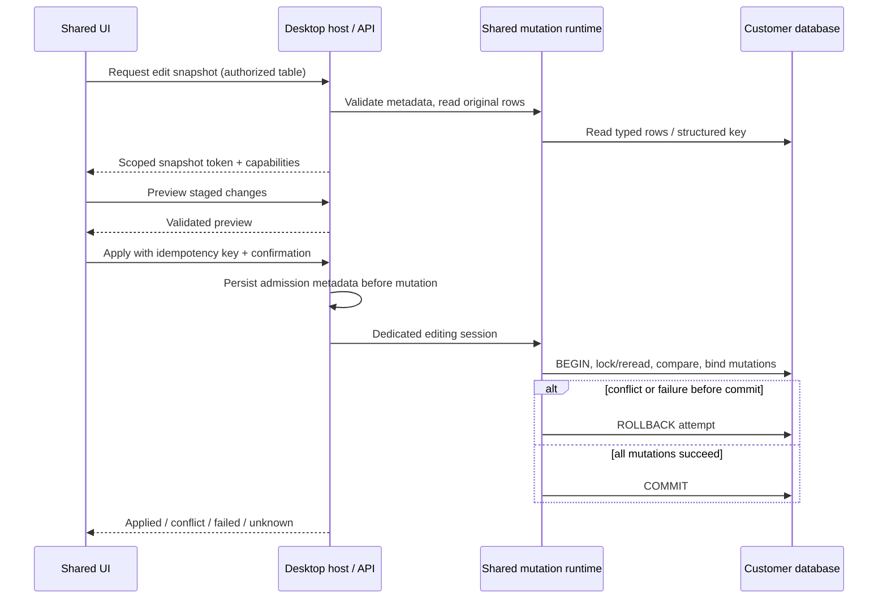

# Phase 4 — Productivity Design Doc

| | |
|---|---|
| **Status** | Approved |
| **Author(s)** | Muhamad Anjar — mengikuti author desain sebelumnya; email tidak dicantumkan |
| **Reviewer(s)** | Pengguna: persetujuan implementasi 2026-10-11; reviewer acceptance/release belum ditetapkan |
| **Tanggal Dibuat** | 2026-10-10 |
| **Terakhir Diupdate** | 2026-10-11 |
| **Service Terkait** | `crates/db-types`, `crates/db-core`, adapters PostgreSQL/MySQL, `crates/query-runtime`, `crates/desktop-runtime`, `services/api`, `packages/shared-types`, `packages/ui`, `apps/desktop`, `apps/web` |
| **Ticket / Issue** | [perlu konfirmasi: issue terkait, jika ada] |

## Ringkasan (TL;DR)

Tingkatkan productivity desktop/web melalui autocomplete kontekstual yang dibatasi, pencarian dokumen terenkripsi, favorit pribadi, navigasi DDL/EXPLAIN dan shortcuts. Tambahkan CRUD grid pada tabel transactional ber-primary key melalui preview, parameter bertipe, pemeriksaan konflik dan transaksi editing khusus tanpa replay mutation. Q1–Q21 dan izin penulisan disetujui 2026-10-10; instruksi “implementasikan” pada 2026-10-11 memberi persetujuan implementasi. Status Approved; acceptance/release masih mengikuti bukti dan gate pada plan.

## Latar Belakang & Masalah

PRD §§16, 28–29, 36 dan 51 menetapkan peningkatan productivity setelah MVP. Baseline sebelum implementasi Phase 4 (2026-10-10): `SqlEditor` menggunakan Monaco dengan daftar keyword/nama, `Workspace` memiliki saved queries/history berhalaman, basic EXPLAIN dan DDL inspection. Belum ada pencarian dokumen, favorit atau staged row editing. Completion provider belum membedakan alias/konteks SQL; hasil tabel memakai pagination tanpa snapshot.

`ColumnMetadata` hanya memuat nama/tipe/null/default/ordinal; constraints berupa definisi teks. Belum ada kontrak structured ordered PK, generated/writable columns atau original-row identity. Hasil `DbValue` lossless, tetapi `BackendSession.execute_bound` menerima `&[String]`, belum typed mutation. `ResultGrid` memakai posisi hasil untuk selection/copy, bukan identitas row untuk write.

SQLite desktop memakai `user_version=1`; application PostgreSQL mensyaratkan schema v1. Migration ladder v1→v2 belum tersedia. Desktop mempunyai generic settings; web settings hanya layout per user/workspace. Record executions sudah menyimpan idempotency tanpa SQL/data, tetapi belum mendefinisikan status batch editing.

[Phase 2](../plans/phase-2-desktop-mvp.md) dan [Phase 3](../plans/phase-3-web-mvp.md) masih Berjalan. Desain Phase 4 boleh berjalan sekarang; gate release fase sebelumnya tidak dianggap selesai.

## Tujuan

- Desktop/web memakai shared core/UI dengan perilaku dan pengujian transport yang konsisten.
- Autocomplete berguna untuk keyword dialect, schema/table/column, alias FROM/JOIN dan qualified names pada statement aktif; tidak mengubah SQL tanpa tindakan pengguna.
- Pencarian nama/SQL saved queries/history tetap scoped dan terenkripsi saat persisten, dengan batas pekerjaan serta continuation yang jujur.
- Insert/update/delete grid menjaga precision, izin, row identity, konflik serta lifecycle transaksi; tidak melakukan retry SQL otomatis.
- Acceptance mempunyai bukti integrasi kedua engine, browser/native, migration/recovery dan benchmark terpisah dari static/unit checks.

## Non-Tujuan (Out of Scope)

- Language server/analisis semantik penuh, seluruh CTE/subquery kompleks, advanced autocomplete, schema diff/migration, ER diagram atau fitur Phase 5.
- Folder/tag shared hierarkis, custom keymap, EXPLAIN ANALYZE otomatis atau visualisasi plan baru.
- Editing view/materialized view, tabel tanpa PK, unique-key fallback, hasil SQL arbitrer, perubahan PK existing atau bulk update/delete seluruh filter.
- Persist/restore draft row setelah restart, autosave mutation, plaintext SQL search index, service editing baru atau exactly-once lintas application/customer database.
- Migration schema customer; migration v2 hanya storage aplikasi.

## Proposal / Desain

### Arsitektur dan urutan

Milestone A meningkatkan productivity; milestone B menambah editing. Core tetap independen dari UI/Axum/Tauri. Shared Rust menangani metadata editability, typed mutation, row identity/conflict dan transaksi; shared UI menangani draft/preview. Desktop host dan API menangani ownership, encrypted storage, admission serta lifecycle sesuai platform.

Kontrak tambahan bersifat additive: jalur query/filter dengan parameter teks tetap berfungsi. API HTTP/WS baru direview pada OpenAPI sebelum consumer; DTO shared dan capability handshake diperbarui bersama. Editing memakai jalur customer connection yang telah diotorisasi, termasuk DNS pin/TLS/network policy Phase 3. Tidak ada jalur koneksi yang melewati guard tersebut.

### Autocomplete dan metadata

Completion mempertimbangkan dialect, statement aktif, FROM/JOIN aliases serta qualified identifiers pada konteks umum. Konteks yang tidak dipahami tidak menghasilkan klaim resolusi semantik; keyword completion tetap tersedia. Metadata dimuat on-demand, bukan preload seluruh katalog.

Cache maksimal **32 MiB/koneksi, 128 MiB/aplikasi/browser**, TTL **5 menit**, maksimal **200 saran**. Cache diinvalidasi saat revisi koneksi, refresh schema, perpindahan workspace, izin berubah/logout. Nilai ini budget cache, bukan janji total RSS. Batas tercapai ditampilkan; target cache hangat **≤200 ms** harus diukur dengan kondisi benchmark.

### Pencarian, favorit dan navigasi

Host desktop/backend web mendekripsi dokumen secara bertahap; browser tidak mengambil seluruh koleksi. Search memakai **POST**, substring case-insensitive atas nama/SQL, filter koneksi/tanggal/status yang relevan, dengan scope authorization yang sama seperti read dokumen. History/editor tetap pribadi dan history default OFF. Saved queries tetap shared workspace; edit/delete mempertahankan ownership dan revision checks.

Per request: scan maksimal **1.000 dokumen, 10 MiB, 2 detik**; response maksimal **100 hasil**. Continuation cursor terikat pengguna/scope dan menjaga urutan stabil. Response membedakan scan selesai dari partial scan: tidak menampilkan “tidak ada hasil” sebelum cakupan habis. Search terms/SQL tidak masuk URL, audit atau logs. Tidak ada plaintext/secondary search index.

Favorit saved query hanya milik pengguna; daftar mendukung search/filter/sort dan CRUD existing. Referensi favorit dibersihkan ketika dokumen dihapus/akses hilang. Favorit tidak memberi akses tambahan. DDL/EXPLAIN biasa mendapat pencarian/navigasi/copy; membuka panel tidak mengeksekusi ANALYZE atau perubahan schema.

Shortcuts bersama mengakomodasi run/save/format/search/navigation/help sesuai fokus dan permission. Pertahankan existing shortcuts, hindari reserved browser/OS, dokumentasikan per platform; tanpa custom keymap pada fase ini.

### Capability editing dan nilai

Hanya base table dengan **structured PK**, termasuk composite PK, dan transactional row locking yang didukung: PostgreSQL atau MySQL **InnoDB**. Nontransactional storage/dependency yang terdeteksi ditolak. Metadata menyatakan ordered key columns, generated/identity/auto-increment, writable/type capabilities serta dependensi yang diketahui. Jangan parse teks DDL untuk menentukan WHERE mutation; nomor visual/offset grid bukan identitas row.

Mutation membedakan **NULL, DEFAULT, nilai kosong dan nilai bertipe**. Precision integer/decimal, temporal, JSON/binary dan tipe lainnya hanya diaktifkan jika binding/decode round-trip engine terbukti aman. Opaque/unsupported values tetap read-only; primary key existing serta generated/identity/auto-increment tidak diedit manual. Default/generated keys/hasil trigger dibaca ulang setelah keberhasilan commit melalui mekanisme engine yang tervalidasi. Identifiers berasal dari metadata terverifikasi dan diquote; nilai dibind, bukan digabung menjadi SQL.

Owner/Admin/Developer memakai execute permission existing; Viewer tetap metadata-only. Host/backend memeriksa scope/role saat preview dan Apply; privilege SELECT/INSERT/UPDATE/DELETE database customer tetap berlaku. Pemeriksaan aplikasi tidak menggantikan constraint/RLS/privilege database.

### Draft, preview, konflik dan Apply

Draft menyimpan perubahan sementara; tidak masuk localStorage, history/editor restore, logs atau audit. Apply selalu explicit preview/confirm yang menunjukkan target dan perubahan, termasuk constraint/FK/trigger yang diketahui. Tidak menjanjikan jumlah cascade/side effects lengkap. Atomicity mencakup perubahan transactional database, bukan efek eksternal trigger atau operasi nontransactional di luar jaminan engine.

Host menerbitkan snapshot identitas/original values terikat pengguna/tab/koneksi/tabel. Snapshot dienkripsi sementara dan tidak dipercaya dari payload browser. Saat Apply, session editing khusus dihitung dalam kuota existing; tidak memakai atau menyelesaikan transaksi tab SQL. Dalam satu transaksi, host mengunci/membaca ulang target dengan urutan deterministik dan membandingkan original values sebelum update/delete. Perubahan/hilangnya row menghasilkan conflict dan rollback seluruh batch; pengguna refresh/review ulang. Constraint/privilege failure juga membatalkan batch bila rollback terkonfirmasi.

Batas: **100 perubahan/batch, payload 1 MiB**, snapshot **8 MiB/tab, 32 MiB/user, 128 MiB/instance**, TTL **10 menit**. Reject kuota penuh tanpa evict draft pengguna lain. Apply deadline **30 detik**; cancellation/timeout sebelum commit mencoba rollback dengan bounded cleanup. Tidak menyatakan rollback berhasil jika outcome tidak dapat dipastikan.

### Idempotency, lifecycle dan storage

Apply menggunakan idempotency key dan canonical request fingerprint terikat scope/user/tab. Admission metadata disimpan sebelum SQL. Response hilang memakai status lookup; tidak repost mutation otomatis. Restart tidak memulihkan live session/snapshot atau replay batch. Application record dan customer commit bukan satu transaksi lintas database; hilangnya kepastian commit menghasilkan **Outcome Unknown**, bukan sukses/rollback tebakan. Pengguna memeriksa data sebelum membuat perubahan baru.

Navigation/close meminta penyelesaian/discard draft; logout/revocation membersihkan snapshot/state dan mengikuti cancellation/cleanup existing tanpa auto-commit. Network reconnect tidak mengulang Apply. Snapshot expired/conflict memerlukan refresh/review ulang. Draft tidak dipulihkan setelah restart.

Tambahkan migration **v2** SQLite/PostgreSQL untuk referensi favorit pribadi dan metadata mutation yang diperlukan, tanpa menyimpan SQL/row data pada record audit/idempotency. Web memakai scoped FK/revision constraints; desktop favorit tetap lokal. Migration memakai backup, transaksi dan schema compatibility guard; API dihentikan sebelum migration. Old binary yang tidak mendukung v2 menolak schema; rollback memakai binary kompatibel atau restore backup, tanpa downgrade otomatis. Detail DDL/DTO/status retention harus direview sebelum implementation dependent.

### Log keputusan — 2026-10-10

- Q1: desain sekarang; gate release Phase 2–3 tetap berlaku.
- Q2: desktop/web bersama dengan shared core/UI dan validasi transport terpisah.
- Q3: productivity dahulu, kemudian editing; Phase 5 di luar cakupan.
- Q4: autocomplete konteks umum, tanpa language server/semantik penuh.
- Q5: scoped host/backend search dengan dekripsi bertahap, tanpa plaintext index.
- Q6: DDL/EXPLAIN biasa; tidak ada ANALYZE otomatis/schema mutation.
- Q7: daftar/search/filter/sort dan favorit pribadi; ownership/revision existing.
- Q8: CRUD base table ber-PK/composite PK; view/no-PK/arbitrary SQL result read-only.
- Q9: dedicated editing session dan transaksi batch atomic dengan preview/confirm.
- Q10: scoped original-row snapshot, lock/reread/compare; conflict rollback batch.
- Q11: typed parameters/NULL/DEFAULT; unsupported/generated/identity/PK existing tidak diedit.
- Q12: idempotency tanpa replay; commit tidak pasti menjadi Unknown.
- Q13: execute role existing, Viewer metadata-only, privilege customer DB tetap berlaku.
- Q14: cache 32/128 MiB, TTL 5 menit, 200 saran; warm response ≤200 ms diukur.
- Q15: POST search, scan 1.000 dokumen/10 MiB/2 detik, 100 hasil, scoped continuation.
- Q16: 100 perubahan/1 MiB; encrypted snapshot 8/32/128 MiB, TTL 10 menit, Apply 30 detik.
- Q17: draft sementara, explicit Apply, scope/lifecycle cleanup; tanpa restore/replay.
- Q18: shared shortcuts focus/permission-aware, tanpa custom keymap.
- Q19: transactional PostgreSQL/InnoDB; efek FK/trigger eksplisit, tanpa janji external atomicity.
- Q20: shared modules/API additive; guarded application v2 migration tanpa customer DDL.
- Q21: integration/browser/native/migration/recovery/benchmark dan regresi menjadi gate.

Pengguna menjawab “ya semua” pada setiap putaran, lalu “ya” atas rangkuman dan izin penulisan. Pada saat itu persetujuan mencakup penulisan Draft; instruksi implementasi 2026-10-11 kemudian mengubah status menjadi Approved.

## Alternatif yang Dipertimbangkan

| Alternatif | Kelebihan | Kekurangan | Kenapa tidak dipilih |
|---|---|---|---|
| Shared core/UI, bounded productivity dan dedicated atomic editing — dipilih | Konsisten lintas platform, isolasi transaksi tab SQL, resource eksplisit | Perlu typed mutation, metadata dan lifecycle baru | Dipilih sesuai Q1–Q21; runtime tetap harus dibuktikan |
| Language server penuh dan preload katalog | Semantik/coverage lebih luas | Kompleksitas, memory dan scope Phase 5 | Tidak sesuai batas Phase 4 |
| Plaintext/secondary SQL search index | Search lebih cepat pada koleksi besar | Information leakage, migration dan key lifecycle tambahan | Dipilih scoped bounded decrypt scan terlebih dahulu |
| Editing ikut transaksi tab SQL | Reuse session dan alur commit pengguna | Dapat mempengaruhi pekerjaan SQL unrelated; rollback batch tidak mandiri | Dedicated session menjaga isolation yang disepakati |
| Unique-key/view/arbitrary-result editing atau overwrite | Coverage lebih luas/lebih sedikit conflict UI | Identitas/permissions/optimistic safety lebih kompleks | PK/base-table restriction dipilih |
| Automatic mutation retry/persisted draft | Recovery tampak lebih mulus | Duplicate side effects dan penyimpanan row data sensitif | Tanpa replay dan explicit Unknown dipilih |
| Service editing terpisah/replacement API | Deployment/interface terpisah | Ownership paralel dan compatibility lebih mahal | Shared additive modules dipilih |

## Dampak & Risiko

- **Backward compatibility:** keep text-parameter query/filter dan existing transport; metadata/typed mutation/API tambahan direview bersama. Uji completion scope lintas tab/engine serta shortcuts agar tidak merusak baseline atau browser actions.
- **Migrasi data:** v1→v2 harus atomic dan backup-verified; scoped favorite cleanup dan mutation metadata tidak boleh memperluas akses SQL/private data. Old binaries menolak v2; restore membutuhkan key versi terkait. Tidak ada migration schema customer.
- **Performa:** decrypt scan, metadata cache, encrypted snapshots, locks dan trigger dapat mahal. Budget bukan hard RSS ceiling atau SLA; ukur 100.000 rows/10.000 objects, warm/cold completion, search continuation, concurrency/lock contention dan cleanup.
- **Keamanan:** backend trusted key/metadata/row identity, parameter binding, fresh role/scope, CSRF, tab ownership dan pin/TLS tetap mandatory. Jangan log SQL/search terms/row values. Viewer/no-access tidak menerima row snapshot; unsupported types tidak mengalami coercion diam-diam.
- **Operasional:** migration/backup/key restore/rollback terpisah dari UI. Reconnect/restart tidak membuktikan commit; expose Unknown dan operator recovery. Nontransactional storage/dependency dan external trigger effects membatasi jaminan atomicity. Release menunggu gate fase sebelumnya serta runtime kedua engine/platform.

## Rencana Implementasi (opsional)

Ikuti [checklist Phase 4](../plans/phase-4-productivity.md): review Draft/contract dan mutation spikes → autocomplete/search/favorites/navigation/shortcuts → structured metadata/typed params → snapshot/preview/atomic mutation → transport/UI lifecycle → migration/recovery → integration/browser/native/benchmark/regression. Kode Phase 4 tersedia; bukti dan keterbatasan pada [validasi](../plans/phase-4-productivity-validation.md).

## Pertanyaan Terbuka

- Persetujuan implementasi dicatat dari instruksi pengguna 2026-10-11. [Perlu konfirmasi: reviewer acceptance/release dan issue terkait].
- Artefak kontrak, DDL, integrity, status dan retention dijelaskan pada [kontrak implementasi](phase-4-productivity-contracts.md); [OpenAPI](../../services/api/openapi.json) additive 1.1.0. Review acceptance independen tetap terbuka.
- [perlu konfirmasi melalui spike: matrix writable/round-trip/comparable types per engine, generated-key readback, conflict comparison untuk JSON/temporal/collation, metadata changes dan kemampuan mendeteksi dependency nontransactional]. Unsupported paths harus fail closed.
- [perlu konfirmasi saat review schema: DDL v2/indexes/scoped FK, upgrade ladder dan compatibility/restore procedure]. Generic desktop settings belum membuktikan migration web atau recovery.
- [perlu konfirmasi melalui pengukuran: cold autocomplete behavior, scan-budget accounting/cursor expiry, snapshot accounting dan fairness]. Target/budget yang disepakati bukan hasil benchmark.
- [perlu konfirmasi: lingkungan runtime/browser/native/provider/egress dan reviewer release]. Gate Phase 2–3 yang terbuka tetap tercatat; tidak dianggap tertutup oleh desain ini.

## Referensi

- [PRD](../../PRD.md) §§16, 28–29, 36, 51; [fitur productivity](../features/productivity-tools.md), [editor/grid](../features/sql-editor-result-grid.md).
- [Plan Phase 4](../plans/phase-4-productivity.md), [Desktop design](2026-10-09-desktop-mvp.md), [Web design](2026-10-10-web-mvp.md).
- [Desktop validation](../plans/phase-2-desktop-mvp-validation.md), [Web validation](../plans/phase-3-web-mvp-validation.md).
- Source recon: `packages/ui/src/{SqlEditor,Workspace,ResultGrid}.tsx`, `crates/db-types/src/lib.rs`, `crates/db-core/src/lib.rs`, adapters, `crates/query-runtime/src/table.rs`, `crates/desktop-runtime/src/persistence.rs`, `services/api/src/{store,routes,documents,runtime}.rs` dan migration v1.
