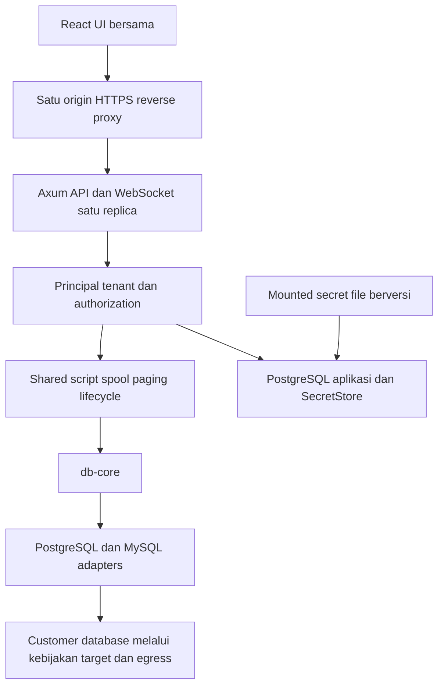

# Phase 3 — Web MVP Design Doc

| | |
|---|---|
| **Status** | Approved |
| **Author(s)** | Muhamad Anjar — mengikuti identitas pada desain repository; email tidak dicantumkan |
| **Reviewer(s)** | [perlu konfirmasi: reviewer backend/security dan deployment] |
| **Tanggal Dibuat** | 2026-10-10 |
| **Terakhir Diupdate** | 2026-10-10 |
| **Service Terkait** | `apps/web`, `services/api`, `packages/ui`, `packages/shared-types`, shared Rust runtime yang akan diekstrak, `crates/db-core`, adapter, `infra/docker` |
| **Ticket / Issue** | [perlu konfirmasi: issue terkait, jika ada] |

## Ringkasan (TL;DR)

Bangun Web MVP multi-organisasi melalui deployment Docker yang dikelola operator, menggunakan Axum, UI/core bersama, login GitHub/Google, dan otorisasi tenant di backend. Query memakai session tetap milik pengguna/tab, encrypted spool dengan kuota, serta WebSocket yang mengirim halaman berdasarkan demand/ACK tanpa replay SQL. Keputusan Q1–Q20 dan izin penulisan dikonfirmasi pengguna; pengguna memerintahkan implementasi dan menyetujui patch transport Q15 pada 2026-10-10. Persetujuan ini bukan bukti gate keamanan/performa lulus.

## Latar Belakang & Masalah

PRD §§22–29, 37–43, 45, 50, dan 53 menetapkan web authenticated dengan organisasi/workspace, encrypted credentials, HTTP/WebSocket, dan PostgreSQL aplikasi terpisah dari customer database. Repository sudah memiliki Foundation, desktop runtime, UI bersama, serta fixture `application-postgres`; belum ada aplikasi web, service Axum, tenant schema, atau auth web.

`DatabaseTransport` pada `packages/shared-types/src/index.ts` menyediakan request/watch dan DTO lossless. Desktop menggunakan encrypted spool serta pull halaman; watch hanya notifikasi. UI masih memanggil file picker, recent files, clipboard, dan close lifecycle desktop. `DesktopHost` memakai SQLite/OS keyring, singleton lock, lookup UUID, dan shutdown global tanpa principal/tenant. Dispatcher tersebut tidak aman untuk diekspos langsung sebagai API multi-user.

[Phase 2](../plans/phase-2-desktop-mvp.md) tervalidasi lokal Linux tetapi acceptance tiga OS/keystore/performa masih terbuka. Desain web berjalan sekarang; implementasi terkait shared core/UI mensyaratkan regresi lulus dan tidak menghapus gate desktop tersebut.

## Tujuan

- Alur login → workspace → secure connection → browse/inspect → script/stream/cancel → transaksi → opt-in history lulus di browser untuk PostgreSQL/MySQL.
- Setiap HTTP request, WebSocket message, session, execution, result, dan dokumen memeriksa tenant serta izin resource; session/hasil/history/editor juga memeriksa pemilik pengguna.
- UI/core tetap bersama; desktop tidak mengalami regresi akibat ekstraksi runtime atau kemampuan platform web.
- Buffer/cache/spool dibatasi per pengguna/workspace/instance; 100.000 rows dan katalog besar diukur pada browser, bukan disimpulkan dari benchmark desktop.
- Deployment, migrasi/restore, secret rotation, egress/DNS/TLS, dan login provider nyata menghasilkan evidence terpisah sebelum fase selesai.

## Non-Tujuan (Out of Scope)

- SaaS publik dengan organisasi self-registration dan tujuan jaringan bebas; organisasi MVP menggunakan undangan.
- Redis, worker terpisah, multi-replica, Kubernetes, collaboration editor, SAML/enterprise SSO, atau engine tambahan.
- Restore transaksi/session/result setelah restart, retry SQL otomatis, atau jaminan arbitrary SQL belum berefek ketika cancellation/disconnect.
- Akses filesystem server dari UI; import workspace/credential desktop otomatis.
- Implementasi KMS/Vault sekarang; abstraction secret store disiapkan. Signing/update desktop serta Phase 4–5 tetap scope terpisah.

## Proposal / Desain

### Komponen dan kompatibilitas

`apps/web` menyediakan bootstrap/login/workspace selection dan HTTP/WebSocket transport. `services/api` memiliki auth, resource authorization, control-plane repositories, registry/lease, serta deployment lifecycle. Script worker, encrypted spool, paging, dan resource policy yang dibutuhkan kedua platform diekstrak bertahap dari desktop runtime ke Rust modules bersama. Nama/lokasi crate final mengikuti review; bukan alasan membuat core bergantung pada Axum/Tauri.

Desktop tetap memiliki SQLite, OS keyring, native capabilities, dan lifecycle lokal. Shared UI memakai kemampuan platform untuk file/clipboard/close. Ekstraksi harus mempertahankan jalur satu-statement, dialect preflight, status protocol authoritative, nilai string lossless/binary base64, typed errors, serta regression tests Foundation/desktop. Patch koneksi/TLS berbeda dari accessor status SQLx yang telah disetujui pada Phase 2.

### Identitas, onboarding, dan session login

GitHub/Google menggunakan OAuth/OIDC sesuai provider; browser tidak menyimpan token utama di localStorage. Identitas provider dipertahankan terpisah; akun tidak otomatis digabung karena email sama. Operator menentukan Owner pertama. Owner memberikan membership organisasi; Owner/Admin memberikan membership workspace sesuai scope kepada akun yang sudah login; login sendiri tidak memberi membership dan tidak membuat organisasi publik.

Production frontend, API, dan WebSocket memakai satu origin HTTPS. Session server-side memakai cookie Secure/HttpOnly/SameSite, CSRF protection untuk mutasi, dan Origin validation untuk WebSocket. Idle login 30 menit; batas absolut 12 jam. Query/background heartbeat tidak memperpanjang idle login tanpa interaksi pengguna. Detail callback/state/PKCE, cookie policy, aktivitas yang memperpanjang login, dan penghapusan token provider harus diselesaikan dalam review auth.

Logout, session expiry, atau pencabutan akses menolak request/message berikutnya, menutup subscriber terkait, dan memulai cancellation/cleanup session database. WebSocket panjang bukan pengecualian terhadap session validity. Perubahan membership harus diterapkan pada request dan resource aktif, bukan hanya saat handshake.

### Role, ownership, dan tenant scope

| Role | Scope dan izin |
|---|---|
| Owner | Mengelola organisasi, membership, workspace, dan koneksi; mempertahankan ownership organisasi |
| Admin | Mengelola workspace yang ditugaskan, membership workspace, koneksi/secret, dan saved queries dalam scope; tidak mengambil alih Owner |
| Developer | Membaca metadata/data, menjalankan query/transaksi, dan mengelola saved queries miliknya; tidak mengubah koneksi/credential/membership |
| Viewer | Membaca metadata struktur; tidak membaca data tabel, menjalankan SQL, atau membaca teks saved queries |

UI permission checks hanya UX. Table Data membutuhkan `query:execute`; jangan menawarkan “SELECT-only” melalui parsing SQL. Jika operator membutuhkan akses database read-only, gunakan credential/privilege database yang sesuai.

Semua repositories menerima organization/workspace scope. Relasi foreign key menjaga resource tetap dalam tenant yang sama. Lookup UUID saja dilarang; payload tenant/owner bukan bukti authorization. History/editor pribadi tetap memeriksa user, termasuk bagi Admin/Owner; saved queries dapat dibaca anggota berizin dan diubah sesuai ownership. Session, execution, result, dan watch tidak dibagikan antaranggota atau tab. RLS bukan syarat MVP dan tidak menggantikan otorisasi resource.

### Control-plane schema dan persistence

PostgreSQL aplikasi menyimpan users, provider identities, organizations/memberships, workspaces/memberships, connections/revisions/secret references, saved queries/revisions, query history, private editor restore, auth sessions, execution/idempotency metadata, dan audit events. Auth session dan database editor session adalah konsep berbeda; live database handles/spool berada dalam proses, bukan SQL application connection.

Credential hanya didekripsi backend ketika membuka customer connection. SecretStore memakai ciphertext di PostgreSQL aplikasi dan mounted secret file berversi di luar database/repository; abstraction dapat diganti KMS/Vault. Tidak ada fallback plaintext. Rotasi mempertahankan referensi versi kunci untuk ciphertext lama sampai re-encryption/recovery selesai. SQL persisten juga dienkripsi; spool memakai kunci ephemeral. Format ciphertext/AAD dan prosedur rotasi final memerlukan review keamanan, tidak dianggap sudah ditentukan melalui pemilihan abstraction.

History dan restore teks default OFF, opt-in per koneksi yang dikelola Owner/Admin. History/editor hanya terlihat oleh pengguna pemilik. History dibatasi 30 hari atau 1.000 eksekusi/koneksi; saved queries tidak terkena pruning otomatis. Saved queries workspace disimpan eksplisit, dengan revision check untuk menolak concurrent overwrite. Developer mengelola miliknya; Owner/Admin mengelola seluruh saved queries dalam scope. Mematikan history/restore tidak boleh diam-diam meninggalkan jalur persistence plaintext.

Migrasi adalah langkah deployment tersendiri dengan backup; aplikasi menolak schema tidak kompatibel. Backup database dan backup key dikelola terpisah; kehilangan kunci tidak diatasi dengan membuat key baru untuk ciphertext lama. Tidak ada migrasi/import data desktop otomatis. DDL, constraints/indexes, concurrency protection, dan prosedur restore akan direview sebelum persistence diimplementasikan.

### HTTP, WebSocket, dan idempotency

API resource-based berversi, dengan OpenAPI sebelum integrasi UI. Resource workspace memiliki scope organization/workspace; session/execution/result memakai scope serta ownership, termasuk cancel/page/watch. HTTP melayani connection CRUD/test, metadata, session/control, creation/cancel/status execution, history, serta saved queries. Bukan endpoint yang meneruskan arbitrary operation ke DesktopHost.

WebSocket melayani lifecycle/progress dan halaman rows berdasarkan permintaan UI. Envelope berversi membawa execution/result identity dan sequence; ACK tervalidasi tidak dapat dipakai ulang untuk membuka credit tambahan. Maksimal satu halaman outstanding, 256 rows/2 MiB per halaman; timeout ACK 30 detik. Status terminal tersedia melalui HTTP ketika consumer terlambat. Frontend tidak menunggu seluruh hasil selesai dan tidak mengumpulkan semua rows. Batas queue gabungan watch/page serta reconnect cursor akan ditetapkan di kontrak; API core events dan representasi transport tidak harus identik.

Pembuatan execution memakai idempotency key yang scoped pengguna/tenant dan membandingkan request. Key/request sama mengembalikan execution sama; key sama/request berbeda ditolak. Replay request atau restart tidak menjalankan SQL kembali. Bila proses mati setelah admission atau efek SQL tetapi sebelum outcome diketahui, status menunjukkan outcome tidak dapat dipastikan dan pengguna harus memilih execution baru secara eksplisit. Retensi record idempotency dan race handling menjadi gate kontrak sebelum eksekusi web.

### Session database, reconnect, dan resource limits

Session tetap dibuka lazy per pengguna/tab, menggunakan core/adapters; satu query aktif/session. Metadata/control tetap terpisah. Auto Commit OFF, Commit/Rollback, arbitrary transaction SQL, failed PostgreSQL transaction, dan implicit commit MySQL mengikuti semantics Phase 2. Tidak ada SQL rewrite/retry atau otomatis Commit.

Browser/network disconnect memiliki grace reconnect 30 detik untuk session/tab yang sama dan pengguna yang masih berizin. Selama grace, query dapat berjalan dalam spool budget. Reconnect membaca status/hasil yang tersedia; tidak membuat execution baru. Lease habis meminta cancellation, menutup session, dan tidak menjanjikan rollback atas semua efek. Logout/revocation/expiry tidak mendapat grace. Hasil selesai sementara tersedia 10 menit; cleanup juga berjalan saat close/delete dan quota failure. Browser close event bukan satu-satunya mekanisme cleanup.

| Resource | Batas awal disepakati |
|---|---|
| Editor sessions | 4/pengguna/koneksi, 8/pengguna, 8/workspace, 16/instance |
| Encrypted spool | 1 GiB/result, 1 GiB/pengguna, 2 GiB/workspace, 4 GiB/instance |
| Frontend retained cache | 32 MiB/tab, 128 MiB/aplikasi |
| Serialized row page | 256 rows, 2 MiB; satu halaman belum di-ACK |
| Lease / ACK / completed result | 30 detik reconnect / 30 detik ACK / 10 menit hasil selesai |

Admission harus memeriksa batas gabungan secara atomik; sesi customer tidak berbagi handle antar-user. Metadata/control memiliki kuota terpisah yang tetap dibatasi global. Saat penuh, tolak pekerjaan baru atau cancel dengan hasil parsial yang ditandai, tanpa menghapus hasil pengguna lain. Budget ini bukan RSS ceiling. Core batch/queue, script 1 MiB/1.000 statements, sort budget, dan DTO limits desktop yang relevan dipertahankan atau diubah hanya melalui kontrak/review eksplisit.

### Target network, TLS, dan pemisahan control plane

Operator mengizinkan target berdasarkan host, port, dan jaringan; customer execution tidak boleh mencapai control-plane database atau endpoint metadata cloud. Kebijakan berlaku pada test/connect, metadata, dan koneksi cancellation, bukan hanya query utama. TLS verified menjadi default; validasi DNS/IP tidak boleh menghilangkan pemeriksaan identitas hostname.

Recon pinned SQLx 0.8.6: PostgreSQL `hostaddr` hanya mengganti field `host`; kedua engine memakai field host yang sama untuk TCP dan TLS. API yang ada belum memisahkan resolved destination IP dari TLS hostname. Spike wajib membuktikan DNS/address validation/pinning dan identitas TLS pada IPv4/IPv6 serta seluruh jalur connection. Jika memerlukan perubahan koneksi/driver, buat review patch tersendiri; persetujuan patch status protocol tidak mencakup perubahan wire/TLS.

Egress jaringan adalah syarat deployment, tetapi API tetap membutuhkan akses control-plane PostgreSQL untuk repositories. Operator/security reviewer harus membuktikan bagaimana jalur customer execution dibatasi tanpa menghilangkan akses aplikasi yang sah. Hostname allowlist atau network diagram saja tidak membuktikan isolasi ini; mekanisme final tetap gate terbuka.

### Browser capabilities dan operations

Open SQL memakai file picker browser; save SQL/CSV memakai download eksplisit; clipboard memakai browser API. File tidak diunggah/disimpan otomatis. Tidak ada arbitrary filesystem server, native recent-file paths, atau global desktop shutdown command. Restore editor tetap pribadi/opt-in tanpa auto-connect/replay.

Deployment Docker satu replica menyediakan frontend/reverse proxy, API/query engine, dan PostgreSQL aplikasi; tanpa Redis/worker. Runtime restart kehilangan handles/ephemeral results; record execution harus menunjukkan outcome unknown/interrupted tanpa replay. Graceful shutdown menghentikan admission dan menunggu cancellation/cleanup secara terbatas. Rollback hanya memakai aplikasi/schema kompatibel atau restore backup terencana; tidak automatic downgrade.

Structured logs/metrics tidak membawa SQL, secrets, tokens, atau row payload. Audit mencatat actor, tindakan, resource, waktu, dan outcome untuk membership/connection/secret serta execution lifecycle; default retensi 90 hari dan configurable operator. Endpoint sensitif memiliki rate limit. Health/readiness dan observability menunjukkan dependency/kuota/latency/errors tanpa membuka data tenant. Nilai rate limit, shutdown budget, dan alert thresholds ditentukan melalui validasi operasional.

### Log keputusan yang dikonfirmasi — 2026-10-10

1. Q1: desain web berjalan; shared regression wajib; gate desktop tetap terpisah.
2. Q2: deployment operator-managed multi-organisasi dengan target allowlist.
3. Q3: Viewer metadata struktur; Data/SQL memerlukan query permission.
4. Q4: history/restore OFF, encrypted SQL, saved queries eksplisit, history 30 hari/1.000 per koneksi.
5. Q5: Owner bootstrap operator, membership undangan, tanpa public organization registration/email auto-link.
6. Q6: role matrix scoped; session/result pribadi, saved queries workspace.
7. Q7: satu origin HTTPS, server session, CSRF/Origin, login idle 30 menit/absolut 12 jam; revoke memulai cleanup.
8. Q8: mounted versioned key + SecretStore abstraction, encrypted PostgreSQL, recovery key terpisah.
9. Q9: reconnect grace 30 detik tanpa replay; hasil selesai 10 menit; revoke tanpa grace.
10. Q10: WebSocket demand pages/ACK 256 rows/2 MiB, satu outstanding, 30 detik timeout, HTTP terminal.
11. Q11: kuota user/workspace/instance seperti tabel; hasil parsial tanpa mengusir pengguna lain.
12. Q12: history/editor pribadi; saved queries ownership/revision; settings Owner/Admin.
13. Q13: browser file picker/download/clipboard, tanpa filesystem server atau automatic upload.
14. Q14: satu replica tanpa Redis/worker; migration/backup/schema guard; restart tanpa recovery/replay live query.
15. Q15: egress wajib; DNS/IP/TLS spike dan driver review terpisah sebelum gate keamanan lulus.
16. Q16: ekstraksi shared runtime bertahap dengan desktop regression; persistence/auth platform terpisah.
17. Q17: versioned resource API/OpenAPI sebelum UI; creation idempotent tanpa reexecution setelah restart.
18. Q18: tenant-scoped repositories/FKs/negative tests; RLS bukan syarat MVP.
19. Q19: audit tanpa SQL/secret/rows, retensi 90 hari; redacted logs, rate limit, metrics.
20. Q20: browser kedua engine, isolation/reconnect/secret/migration/deployment/provider nyata dan stress/benchmark menjadi gates.

## Alternatif yang Dipertimbangkan

| Alternatif | Kelebihan | Kekurangan | Kenapa tidak dipilih |
|---|---|---|---|
| Operator-managed allowlist — dipilih | Scope operasional/target terkendali | Memerlukan konfigurasi dan bukti egress | Dipilih untuk MVP; bukan SaaS target bebas |
| SaaS publik/target bebas | Onboarding luas | Abuse, jaringan, dan isolasi lebih kompleks | Tidak sesuai scope Q2/Q5 |
| Shared execution modules + web application layer — dipilih | Lifecycle konsisten, auth/storage platform jelas | Refactor dan regresi desktop | Dipilih; bukan mengekspor DesktopHost |
| Salin runtime / expose desktop dispatcher | Setup awal cepat | Divergensi atau lookup tanpa tenant/shutdown global | Tidak menjaga kontrak/ownership web |
| Demand pages + ACK — dipilih | Bounded delivery, resume tanpa SQL replay | Perlu sequence/lease/queue tests | Dipilih untuk resource policy |
| Push semua rows | Protocol lebih sederhana | Antrean/memory browser dapat tumbuh | Tidak memenuhi buffering terbatas |
| Versioned mounted key — dipilih | Deployment MVP tanpa layanan tambahan | Operator bertanggung jawab rotation/recovery | Dipilih dengan abstraction dan review format |
| KMS/Vault wajib sejak MVP | Key management terpusat | Dependency operasi/setup tambahan | Integrasi konkret ditunda |
| Satu replica — dipilih | Session/spool ownership sederhana | Restart kehilangan live state, kapasitas terbatas | Dipilih sampai ada kebutuhan scaling terbukti |
| Multi-replica/worker/Redis | Kapasitas/availability lebih luas | Routing/coordinasi session dan resource | Di luar kebutuhan MVP |
| Repository scope + FKs — dipilih | Authorization eksplisit/testable | Semua jalur harus disiplin scope | Dipilih dengan pengujian negatif |
| RLS wajib sekarang | Defense tambahan pada database | Konteks pool/session dan operasi bertambah | Bukan pengganti permission; ditunda |

## Dampak & Risiko

- **Backward compatibility:** ekstraksi runtime dan capability UI dapat merusak desktop. Pertahankan contracts/version handshake, lossless cells, script/cancel/transactions, serta regresi native/core. Public web API baru wajib OpenAPI/review sebelum consumer; perubahan driver memerlukan gate tersendiri.
- **Migrasi data:** schema PostgreSQL aplikasi baru, tanpa import desktop/customer migration. Migration transaction/backup/compatibility guard dan revision checks perlu diuji. Restore database tidak cukup tanpa key versi terkait; reversal memakai aplikasi/schema kompatibel atau backup. Idempotency record harus bertahan restart agar SQL tidak direplay.
- **Performa:** satu replica, fairness user/workspace, disk/encryption/WebSocket overhead, dan retained cache tidak menjamin RSS. Uji 100.000 rows, katalog 10.000+ object, quota races, slow/disconnected consumers, dan cleanup; catat browser/server/process conditions. Target startup/RSS desktop tidak dipindahkan menjadi SLA web tanpa pengukuran.
- **Keamanan:** endpoint/message/object authorization, private history/results, CSRF/Origin/session expiry, account linking, secret/AAD/rotation, DNS/TLS/egress/control-plane routing adalah review wajib. Arbitrary SQL hanya pada authorized customer connection. Allowlist teks saja tidak membuktikan DNS/routing isolation; Viewer tidak boleh bypass melalui table viewer.
- **Operasional:** operator menyediakan TLS/origin, provider callbacks, initial Owner, versioned keys, policy jaringan, backups, dan satu replica. Health, rate limits, audit pruning, graceful shutdown, crash cleanup, restore, dan rollback perlu evidence Docker/pipeline; config yang belum diuji bukan bukti deployment. Login provider nyata tetap gate tersendiri dari test provider lokal.

## Rencana Implementasi (opsional)

Ikuti [checklist Phase 3](../plans/phase-3-web-mvp.md): review/security spikes → extraction/desktop regression → OpenAPI/schema/auth → membership/secret/egress → sessions/HTTP/WebSocket → shared browser UI/privacy → Docker/recovery → E2E/benchmark/pipeline. Implementasi tersedia; acceptance runtime/deployment masih terbuka pada laporan validasi.

## Pertanyaan Terbuka

- [perlu konfirmasi: reviewer release backend/security/deployment dan issue]. Pengguna telah menyetujui implementasi serta patch Q15; review release tetap terpisah.
- Bukti DNS berubah, TLS match/mismatch/CA, IPv4/IPv6, egress Docker, OAuth provider nyata, backup/restore, benchmark dan pipeline belum tersedia.
- [perlu konfirmasi saat deployment: origin, akun provider, bootstrap subject, operator backup dan lingkungan acceptance]. Secret tidak dicantumkan pada dokumen.

### Detail implementasi yang dipilih — 2026-10-10

`services/api/openapi.json` menjadi kontrak `/api/v1`; DDL v1 berada di `services/api/migrations/0001_web.sql`. Cookie server-side dan CSRF hash memisahkan login dari token tab `X-Studio-Tab`; WS hello membawa token tab/CSRF. Idempotency menggunakan HMAC versioned, scope user/login/tab dan tombstone terminal 30 hari; admission disimpan sebelum SQL, restart menandai interrupted tanpa replay.

SecretStore memakai AEAD dengan AAD tenant/resource/owner/kind, versioned key mode 0600 dan tanpa fallback. Key lama dipertahankan untuk HMAC/backup. Editor dibatasi 16/koneksi dan 64/user; antrean page browser 32, watch 16, satu outstanding ACK; admission hard quota dan hierarchical spool atomic. Driver pin menyimpan IP tervalidasi pada config internal, mempertahankan hostname TLS, dan memvalidasi ulang DNS untuk koneksi baru. Seluruh jawaban DNS harus diizinkan.

[Review patch Q15](phase-3-driver-pinning-review.md), [runbook](../plans/phase-3-web-mvp-operations.md), dan [bukti validasi](../plans/phase-3-web-mvp-validation.md) mencatat artefak serta batas bukti.

## Referensi

- [PRD](../../PRD.md), [plan Phase 3](../plans/phase-3-web-mvp.md), [fitur web](../features/web-auth-workspaces.md), [deployment](../features/deployment-observability.md).
- [Foundation](2026-10-09-foundation.md), [Desktop MVP](2026-10-09-desktop-mvp.md), [evidence desktop](../plans/phase-2-desktop-mvp-validation.md), [patch status protocol](phase-2-driver-status-review.md).
- [Shared transport types](../../packages/shared-types/src/index.ts), [desktop transport](../../apps/desktop/src/transport.ts), [desktop runtime](../../crates/desktop-runtime/src/host.rs), [core runtime](../../crates/db-core/src/runtime.rs).
- [Pinned PG options parser](../../vendor/sqlx-postgres/src/options/parse.rs), [PG TLS](../../vendor/sqlx-postgres/src/connection/tls.rs), [MySQL TLS](../../vendor/sqlx-mysql/src/connection/tls.rs): host TCP/TLS belum terpisah pada jalur yang ada.
- [OWASP WebSocket Security](https://cheatsheetseries.owasp.org/cheatsheets/WebSocket_Security_Cheat_Sheet.html), [Session Management](https://cheatsheetseries.owasp.org/cheatsheets/Session_Management_Cheat_Sheet.html), [SSRF Prevention](https://cheatsheetseries.owasp.org/cheatsheets/Server_Side_Request_Forgery_Prevention_Cheat_Sheet.html).
