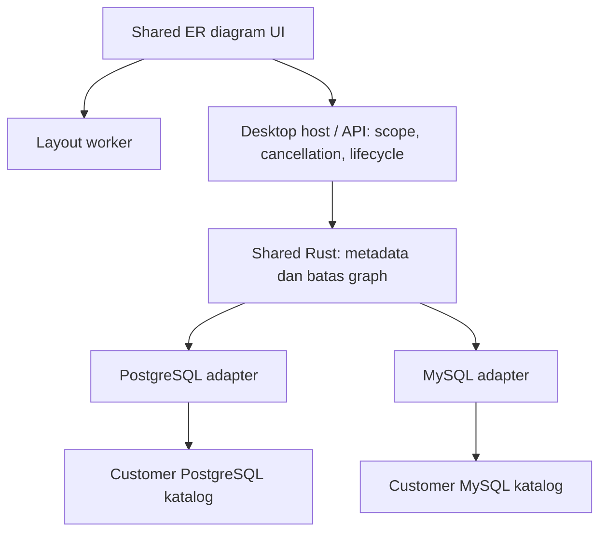

# Phase 5 — ER Diagram Read-only Design Doc

|                       |                                                                                                                                                                                            |
| --------------------- | ------------------------------------------------------------------------------------------------------------------------------------------------------------------------------------------ |
| **Status**            | Draft                                                                                                                                                                                      |
| **Author(s)**         | Muhamad Anjar — mengikuti author desain sebelumnya; email tidak dicantumkan                                                                                                                |
| **Reviewer(s)**       | [perlu konfirmasi: reviewer kontrak/keamanan, UI/performa, dan acceptance/release]                                                                                                         |
| **Tanggal Dibuat**    | 2026-10-12                                                                                                                                                                                 |
| **Terakhir Diupdate** | 2026-10-12                                                                                                                                                                                 |
| **Service Terkait**   | `crates/db-types`, `crates/db-core`, `crates/db-postgres`, `crates/db-mysql`, `crates/desktop-runtime`, `services/api`, `packages/shared-types`, `packages/ui`, `apps/desktop`, `apps/web` |
| **Ticket / Issue**    | [perlu konfirmasi: issue terkait, jika ada]                                                                                                                                                |

## Ringkasan (TL;DR)

Phase 5 dimulai dengan ER diagram read-only untuk memahami relasi FK pada tabel pilihan pengguna di desktop/web, PostgreSQL/MySQL. Diagram memakai metadata katalog terstruktur, perluasan eksplisit, layout sementara dan batas resource; tidak membaca row data atau mengubah schema. Q1–Q12 serta rangkuman/izin penulisan dikonfirmasi pengguna pada 2026-10-12; dokumen masih Draft dan belum memberi persetujuan implementasi atau menutup gate release Phase 2–4.

## Latar Belakang & Masalah

PRD §52 dan roadmap Phase 5 mencantumkan schema tools, language tools dan platform/access sebagai kandidat, bukan komitmen seluruh fitur. Pengguna memilih ER diagram read-only sebagai milestone awal; kandidat lainnya tetap future scope. Desain boleh berjalan sekarang sementara acceptance/release Phase 2–4 tetap mengikuti bukti masing-masing.

Recon graph/source menemukan `MetadataRequest` menyediakan Databases, Schemas, Objects dan Inspect. `MetadataResponse` menyediakan objects, columns, indexes, constraints, DDL dan editing metadata; `ConstraintMetadata` hanya mempunyai name, kind dan definition teks. Adapters mengambil FK dari katalog tetapi belum mengekspos pasangan kolom sumber/target sebagai relasi terstruktur. PK terurut tersedia pada editing metadata. Inspector/explorer dan transport bersama dapat menjadi titik integrasi; completion Phase 4 tetap analisis konteks terbatas, bukan language engine.

Metadata inspector saat ini bukan kontrak pemuatan graph bounded. Beberapa query memakai `fetch_all`; jalur diagram perlu memastikan pembatasan di backend sebelum materialisasi seluruh katalog. Metadata memakai koneksi terpisah dari transaksi tab SQL, sehingga tidak menunjukkan temporary/uncommitted objects tab tersebut.

## Tujuan

- Memahami FK tabel pilihan melalui diagram read-only yang konsisten pada kedua platform/engine.
- Menampilkan composite FK dengan pasangan kolom berurutan, self-reference, cycle dan relasi lintas schema dalam database koneksi aktif.
- Mendukung perluasan FK masuk/keluar eksplisit, drag, auto-layout, zoom/pan, pencarian tabel dan navigasi inspector.
- Mempertahankan scope/izin metadata existing, compatibility transport dan core yang independen dari UI/network.
- Membuktikan budget, cancellation, metadata parsial dan lifecycle dengan unit, integrasi database, browser/native serta benchmark terpisah.

## Non-Tujuan (Out of Scope)

- Schema diff/migration, DDL generator, schema editing, inferensi relasi bisnis/kardinalitas, view dependency dan analisis SQL.
- Advanced autocomplete/refactoring/go to definition, database agent, SSH tunnel, enterprise auth, self-hosted dan packaging/signing/auto-update pada milestone ini.
- Memuat seluruh schema otomatis, berpindah koneksi/database untuk mengikuti FK, membaca row data atau meningkatkan privilege.
- Persistence layout/diagram, sharing dan ekspor SVG/PNG; tidak ada migrasi storage aplikasi atau customer schema.
- Snapshot schema konsisten saat concurrent DDL, live schema subscription dan visibility temporary/uncommitted objects tab SQL.

## Proposal / Desain

### Ownership dan integrasi

Shared Rust menangani pembacaan/normalisasi metadata FK dan batas graph; adapters mempertahankan perilaku katalog engine-specific. Shared UI menangani state diagram dan interaksi; auto-layout berjalan di worker agar UI tetap responsif. Host desktop/API menangani authorization, cancellation serta lifecycle. Tidak ada service baru; penempatan fungsi/module konkret tetap perlu review kontrak sebelum implementasi.

Kontrak FK/diagram ditambahkan secara additive pada Rust/shared DTO dan IPC/HTTP. Inspector/query/filter existing tetap kompatibel. Field relasi memuat identitas tabel sumber/target, pasangan kolom berurutan, identitas constraint, aturan UPDATE/DELETE dan status constraint bila engine menyediakan. DDL/definition teks existing tetap tersedia untuk inspeksi; tidak diurai menjadi sumber kebenaran FK. Jalur query diagram harus bounded; memotong hasil di UI setelah seluruh katalog diambil tidak memenuhi desain.

Nama request/endpoint, schema DTO, capability handshake dan representasi error/partial belum ditetapkan. Review terhadap OpenAPI existing diperlukan sebelum consumer, tanpa mengarang endpoint dalam Draft ini.

### Subgraph dan makna relasi

Pengguna memilih tabel awal dan memperluas FK masuk/keluar secara eksplisit; tidak ada preload seluruh schema atau perluasan rekursif otomatis. Relasi hanya berasal dari FK deklaratif database. Diagram menunjukkan pasangan kolom, aturan referensial dan status constraint jika tersedia, tanpa klaim kardinalitas bisnis atau hasil scan data.

Tabel target di luar subgraph ditandai belum dimuat. Target yang tidak boleh diakses tidak menampilkan detail tambahan; privilege aplikasi/customer database tetap berlaku. Ketika metadata gagal, dibatasi atau tidak lengkap, status parsial ditampilkan dan UI tidak menyimpulkan “tidak ada relasi”. Cross-schema tetap dalam database koneksi aktif; perilaku referensi ke database lain memerlukan aturan kontrak eksplisit sebelum implementasi.

Tidak ada pembacaan row data, schema mutation atau operasi Apply. Izin metadata existing termasuk Viewer dipertahankan; metadata connection tidak memberi hak execute/editing tambahan. Nama object/constraint merupakan input tidak tepercaya untuk rendering. Batas visibilitas katalog kedua engine harus diuji agar relasi tidak membocorkan detail target di luar akses yang berlaku.

### Resource, refresh dan lifecycle

Budget awal **per diagram**: maksimal **100 tabel, 500 FK, 2.000 kolom, payload metadata 5 MiB**. Deadline pemuatan **10 detik** dan cancellation tersedia. Perluasan yang melewati batas ditolak dengan penjelasan; UI tidak menyatakan graph lengkap ketika pembacaan parsial. Accounting payload, bagian graph parsial serta cara menerapkan batas pada katalog perlu dirinci melalui kontrak/spike. Budget ini bukan bukti total RSS, fairness atau SLA.

Target awal render/layout **≤2 detik setelah metadata diterima**, diukur terpisah dari database/network. Benchmark katalog 10.000 objek memakai subgraph maksimum budget; evaluasi juga mencakup wide tables, dense/cyclic graph, worker memory dan main-thread responsiveness.

Diagram merupakan hasil inspeksi saat dimuat, dengan waktu pemuatan dan refresh manual. Tidak menjanjikan snapshot konsisten ketika concurrent DDL. Perubahan yang terdeteksi ditampilkan sebagai partial/perubahan metadata; hasil lama dari request yang selesai terlambat dibuang. Refresh mempertahankan posisi tabel yang masih cocok, sementara matching identitas dan konflik perubahan nama perlu ditetapkan di kontrak.

Pergantian koneksi/revisi, workspace, logout atau pencabutan akses membersihkan state diagram dan hasil pemuatan terkait. Layout bersifat sementara; diagram tidak masuk storage aplikasi. Cleanup request/worker dan batas konkurensi tetap perlu spesifikasi sebelum implementasi. Jalur akses memakai authorization serta kebijakan jaringan/TLS existing, tanpa koneksi alternatif yang melewati guard.

### Log keputusan — 2026-10-12

- Q1: ER diagram read-only dipilih sebagai fitur awal Phase 5; kandidat lain tetap future scope.
- Q2: desktop/web dan PostgreSQL/MySQL bersama, reuse core/UI serta bukti transport terpisah.
- Q3: desain sekarang; gate release Phase 2–4 tetap berlaku.
- Q4: tabel pilihan dan perluasan FK masuk/keluar eksplisit; composite/self/cross-schema dalam database aktif, tanpa relasi inferred/view dependency.
- Q5: metadata FK katalog terstruktur melalui shared Rust/adapters; transport additive, tanpa parsing DDL sebagai sumber kebenaran.
- Q6: layout sementara dengan drag/auto-layout/zoom/pan/search/navigasi inspector; tanpa persistence/ekspor.
- Q7: izin metadata existing termasuk Viewer; scope/privilege tetap berlaku, tanpa row data/elevasi, partial tidak disamakan dengan tidak ada relasi.
- Q8: FK deklaratif, pasangan kolom/UPDATE/DELETE/status bila tersedia; tanpa tebakan kardinalitas, target belum dimuat dibedakan dari akses terbatas.
- Q9: 100 tabel/500 FK/2.000 kolom/5 MiB per diagram, deadline 10 detik/cancel; backend bounded, perluasan melewati batas ditolak.
- Q10: inspeksi saat dimuat, refresh manual/waktu pemuatan, tanpa snapshot concurrent DDL; posisi yang cocok dipertahankan, stale results dibuang dan scope cleanup berlaku.
- Q11: shared Rust metadata/batas, UI layout worker, host authorization/cancel/lifecycle; tanpa service/schema migration, disable fitur untuk rollback dan pertahankan kontrak released.
- Q12: integrasi kedua engine/browser/native/failure paths/benchmark terpisah; katalog 10.000 objek dan render/layout ≤2 detik setelah metadata diterima.

Pengguna menjawab “ya semua” pada tiga putaran, kemudian “ya” atas rangkuman dan izin menulis/register Draft. Review manusia dan persetujuan implementasi belum dilakukan. Alur status: Draft → In Review → Approved → Implemented; Rejected/Deprecated terminal. In Review hanya setelah review manusia.

## Alternatif yang Dipertimbangkan

| Alternatif                                                                      | Kelebihan                                                       | Kekurangan                                                        | Kenapa tidak dipilih                              |
| ------------------------------------------------------------------------------- | --------------------------------------------------------------- | ----------------------------------------------------------------- | ------------------------------------------------- |
| ER read-only, subgraph eksplisit, katalog terstruktur, kedua platform — dipilih | Reuse metadata/core/UI, scope bounded, tanpa mutation/migration | Memerlukan kontrak FK dan pembacaan bounded baru                  | Dipilih Q1–Q12; acceptance belum terbukti         |
| Schema diff/migration sebagai fitur awal                                        | Membantu perubahan schema langsung                              | Risiko DDL, reversibility dan perbedaan engine lebih besar        | ER read-only diprioritaskan                       |
| Seluruh schema dimuat/ditata otomatis                                           | Gambaran global langsung                                        | Beban katalog/layout, graph padat dan kontrol scope lebih sulit   | Subgraph pilihan dengan budget dipilih            |
| Parsing DDL/constraint teks                                                     | Memakai output inspector existing                               | Variasi syntax/quoting dan mapping composite FK rawan salah       | Katalog terstruktur dipilih                       |
| Desktop dahulu                                                                  | Mengurangi scope transport awal                                 | Web tertunda dan risiko kontrak hanya sesuai desktop              | Kedua platform dipilih                            |
| Layout persisten dan ekspor sejak awal                                          | Diagram dapat dipakai ulang/dibagikan                           | Storage/migration serta distribusi metadata perlu desain tambahan | Layout sementara dipilih                          |
| Tunda desain sampai Phase 4 diterima                                            | Fokus gate sebelumnya                                           | Keputusan roadmap ikut tertunda                                   | Desain sekarang dengan gate release tetap berlaku |

## Dampak & Risiko

- **Backward compatibility:** DTO/IPC/HTTP additive; endpoint dan capability konkret direview sebelum consumer. Uji regresi metadata inspector, query, session dan transaksi existing. Disable fitur tidak mencabut kontrak yang sudah dirilis.
- **Migrasi data:** N/A untuk migration storage/customer schema karena layout sementara dan operasi hanya metadata read. Tidak ada data tersimpan yang perlu downgrade; periksa jalur state agar metadata diagram tidak terpersist tanpa sengaja.
- **Performa:** katalog, FK masuk, wide tables dan graph padat dapat mahal. Enforce budget/deadline di backend, cancellation, worker layout serta benchmark 10.000 objek; nilai budget/target belum merupakan hasil pengukuran. Fairness, concurrent diagrams dan total memory perlu kontrak/spike.
- **Keamanan:** scope/role/privilege existing termasuk Viewer tetap berlaku. Hindari row reads, privilege escalation, cross-scope cache/results, unsafe rendering serta kebocoran detail target yang dibatasi. Ikuti privacy/logging dan pin/TLS existing; identitas object serta request tidak dipercaya dari client.
- **Operasional:** fitur dapat dinonaktifkan tanpa migration balik; mekanisme disable/version compatibility perlu kontrak. Partial, timeout, permission failure dan concurrent DDL harus terlihat jelas. Gate Phase 2–4, browser/native, security, benchmark dan reviewer release tetap terpisah dari unit/static evidence.

## Rencana Implementasi (opsional)

Setelah review manusia dan approval: review DTO/OpenAPI/capabilities serta spike katalog bounded/visibility → implementasi metadata FK kedua adapters/shared graph → host scope/cancel/lifecycle → UI dan layout worker → integration/browser/native/benchmark/regression → review acceptance/release. Ikuti [plan Phase 5](../plans/phase-5-advanced-ide.md); implementasi belum dimulai.

## Pertanyaan Terbuka

- [perlu konfirmasi: reviewer kontrak/keamanan, UI/performa dan acceptance/release, serta issue bila ada].
- [perlu konfirmasi melalui review kontrak: request/endpoint IPC/HTTP, DTO FK/status/partial/error, capability/version compatibility dan mekanisme disable]. Reviewer kontrak sebelum consumer.
- [perlu konfirmasi melalui spike: katalog FK masuk/keluar bounded, visibilitas target kedua engine, mapping composite FK/status dan referensi di luar database aktif]. Reviewer adapters/keamanan; jangan membuka detail target restricted.
- [perlu konfirmasi melalui review kontrak: accounting 5 MiB/kolom/edge/tabel termasuk target belum dimuat, atomicity perluasan yang ditolak, pagination/partial semantics dan consistency saat concurrent DDL]. Reviewer core/performa.
- [perlu konfirmasi melalui desain UI/spike: renderer/layout worker dan dependensi, matching identitas saat refresh/rename, keyboard accessibility, cleanup worker/request, batas concurrency/fairness dan memory]. Reviewer UI/performa. Pemilihan library belum dilakukan.
- [perlu konfirmasi melalui pengukuran: hardware/browser/native matrix dan definisi pengukuran render/layout ≤2 detik]. Reviewer acceptance; target tidak dianggap lulus tanpa artefak.

## Referensi

- [PRD](../../PRD.md) §§4, 13–14, 24, 39–40, 52.
- [Plan Phase 5](../plans/phase-5-advanced-ide.md), [fitur advanced IDE](../features/advanced-ide.md), [explorer/inspector](../features/database-explorer-inspector.md).
- [Productivity design](2026-10-10-productivity.md), [kontrak Phase 4](phase-4-productivity-contracts.md), [validasi Phase 4](../plans/phase-4-productivity-validation.md).
- [Desktop design](2026-10-09-desktop-mvp.md), [Web design](2026-10-10-web-mvp.md), [runbook web](../plans/phase-3-web-mvp-operations.md).
- Recon graph/source: [metadata contracts](../../crates/db-types/src/lib.rs), [PostgreSQL](../../crates/db-postgres/src/metadata.rs), [MySQL](../../crates/db-mysql/src/metadata.rs), [shared transport](../../packages/shared-types/src/index.ts), [inspector](../../packages/ui/src/Workspace.tsx). Recon bukan bukti runtime Phase 5.
